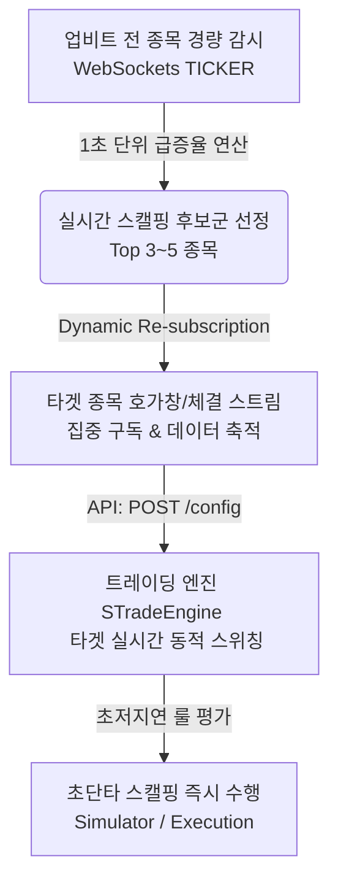

# Trading Strategy Guide

CTrade의 다이내믹 룰 엔진을 활용하여 파이썬 코드 수정 없이 매매 전략을 구축하는 가이드입니다.

## 1. 전략 설정 구조
CTrade는 **전략 템플릿(STRATEGY_TEMPLATES)**과 **개별 종목 타겟(SCALPING_TARGETS)**을 분리한 디커플링 설정을 채택합니다. 이를 통해 종목별 하드코딩 중복을 줄이고, 공통 전략의 일괄 관리 및 개별 종목 오버라이드를 완벽히 실현합니다.

### ⚙️ 핵심 설정 구조 및 키 설명

#### A. GLOBAL_STRATEGY (전역 전략 설정 레이어) [NEW]
시스템 전반의 운용 한도 및 전역 변수를 정의합니다.
* **`SIMULATION_MODE`**: 가상 모의 매매 엔진(`VirtualTrader`) 활성화 여부 (`true`/`false`).
  * `false` (실전 매매): 실제 거래소 API(업비트/KIS)로 실주문 집행, 알림에 `🔴 실전매매` 뱃지 및 실제 거래소 잔고만 표기 (가상 1천만 원 배제), 실전 체결 내역만 독립 통산 집계.
  * `true` (가상 매매): 가상 모의 엔진으로 체결, 알림에 `🔵 가상매매` 뱃지 및 가상 운용 잔고 표기, 가상 체결 내역만 독립 통산 집계.
* **`SIMULATION_INITIAL_BALANCE`** [NEW]: 모의 시뮬레이션 시작 자본금 (기본값: `10,000,000` = 1,000만원). ROI(수익률) 산출 기준 및 시뮬레이션 완전 초기화 시 복원되는 총 자산입니다.
* **`INVEST_AMOUNT`**: 기본 1회 매수 예산 기준값 (원 단위).
* **`UI_FOCUS_SYMBOL`**: 대시보드 진입 시 최초 포커스할 기본 종목.
* **`EXCHANGE_RATE_MODE`**: 원화 환산 시 참고할 기준 통화 모드 (예: `USDT`).
* **`EMERGENCY_EXIT_TIMEOUT`**: 본전 탈출(Emergency Exit) 대기 제한 시간 (초 단위).
* **`MAX_ACTIVE_TARGETS`**: 동시 활성화(`active: true`)하여 실시간 공략할 수 있는 최대 종목 수 (기본값: `10`, **대시보드 STRATEGY EDITOR에서 실시간 수정 및 설정 가능**).
* **`DETECTOR_ENTRY_RVOL`**: 실시간 거래량 탐지기 진입 상대 거래량 임계값 (%, 기본값: `500.0`).
* **`DETECTOR_ENTRY_VBP`**: 실시간 거래량 탐지기 진입 순매수 체결 비율 임계값 (%, 기본값: `65.0`).
* **`DETECTOR_ENTRY_TPS`**: 실시간 거래량 탐지기 진입 초당 틱 수 임계값 (tps, 기본값: `2.0`).
* **`DETECTOR_EXIT_RVOL`**: 실시간 거래량 탐지기 이탈 상대 거래량 임계값 (%, 기본값: `100.0`).
* **`DETECTOR_EXIT_VBP`**: 실시간 거래량 탐지기 이탈 순매수 체결 비율 임계값 (%, 기본값: `50.0`).
* **`DETECTOR_EXIT_TPS`**: 실시간 거래량 탐지기 이탈 초당 틱 수 임계값 (tps, 기본값: `0.5`).
* **`SPREAD_FILTER_MAX_PCT`**: 호가 스프레드 리스크 절대 제한 임계값 (%, 기본값: `0.15`).
* **`SPREAD_FILTER_MULT`**: 역사적 EMA 스프레드 대비 진입 억제 배율 (기본값: `1.5`).
* **`BASIS_VELOCITY_MIN_LIMIT`**: 선물-현물 괴리율(Basis)의 최소 변화 속도 제한값 (%, 기본값: `0.02`).
* **`SIMULTANEOUS_SPIKE_LIMIT`**: 동일 초(또는 1초 내)에 동시에 트리거되는 스파이크 종목 수 제한값 (기본값: `3`). 초과 시 메이저 선행 종목 외 알트코인 차단.
* **`MIN_PRICE_SLOPE_3S`**: 진입 직전 최근 3초간의 최소 가격 상승률 임계값 (%, 기본값: `0.05`). 미달 시 허수 거래량에 의한 진입 차단.
* **`DETECTOR_MIN_TRADE_VAL_1M`**: 레이더 1차 필터용 최근 1분 최소 거래액 기준 (원, 기본값: `100,000,000` = 1억원). 초단타에서 실체결 가능한 유동성 최소 요건.
* **`DETECTOR_KIMCHI_DELTA_MIN`**: 업비트-바이낸스 괴리율의 기저 EMA 대비 최소 상승 폭 (%, 기본값: `0.05`). 절대 김치프리미엄이 아닌 **종목별 상대 변화량**으로 측정.
* **`KIMCHI_PREMIUM_EMA_ALPHA`**: 김치프리미엄 기저 EMA 감쇠율 (기본값: `0.002`). 작을수록 안정적 기저값 추적 (예: 항상 5% 김프인 종목은 기저 EMA≈5% 수렴).
* **`TEST_LEVEL`** [UPDATE]: 4단계 테스트 매매 모드 레벨 (`0: OFF`, `1: MILD`, `2: ACTIVE`, `3: TURBO`). 웹 대시보드 상단 버튼 클릭 시 원터치 순환 토글.
  * **🔒 상호 배제 안전 잠금**: 실전 매매(`SIMULATION_MODE: false`) 중에는 `TEST_LEVEL > 0` 활성화 불가, 테스트 모드 활성화 중에는 실전 매매 전환 불가.
  * **레벨별 파라미터**:
    - **Lv.0 (OFF)**: 원본 모델 `buy_threshold` (0.52~0.55), 원본 `cooldown` (5분), 정규 필터 & KRX 장시간(09:10~15:00) 준수
    - **Lv.1 (MILD)**: `buy_threshold=0.5000`, `cooldown=1분`, 매크로 필터 완화
    - **Lv.2 (ACTIVE)**: `buy_threshold=0.4700`, `cooldown=0분 (즉시 재진입)`, 매크로 해제, **모의 매매 시 야간/장마감 시간제약 우회 (`bypass_krx_time_limit: true`)**
    - **Lv.3 (TURBO)**: `buy_threshold=0.4000`, `cooldown=0분`, 모든 필터/시간제약 완전 우회 (모의 시뮬레이션 전용 체결 폭풍)
* **`TEST_MODE`**: 기존 하위호환 플래그 (`TEST_LEVEL > 0` 시 `true`).


#### B. STRATEGY_TEMPLATES (전략 템플릿 레이어)
자주 재사용되는 공통 매매 룰셋을 정의합니다.
* **`ai_baker` / `ai_kodex200` / `ai_samsung`** [UPDATE]: CAiModelBaker에서 학습한 LightGBM 모델 기반 실전 AI 매매 전략 템플릿.
  * `type`: `AI_BAKER` — 엔진이 룰 엔진 대신 `AIStrategyModule`로 자동 분기
  * `deploy_base`: Baker deploy 디렉토리 상대경로 (예: `../shared/deploy/005930_1m`, `../shared/deploy/069500_10s`, `../shared/deploy/BTC_10m`)
  * `deploy_session`: 배포 세션 ID (예: `SAMSUNG_M1_BEST1`, `KODEX200_S10_BEST260921`, `KODEX200_M1_BEST3`, `BTC_M10_BEST7`, `BTC_M15_TEST1`)
  * **모델 버전 무결성 (Model Fingerprint)**: `model_{interval}.txt` 가중치의 SHA-256 해시 앞 8자리를 고유 지문으로 추출하여 CAiModelBaker와 CTrade 간 모델 버전 일치 여부(Parity) 및 실제 학습일시(`created_at`), 학습데이터구간(`train_start`~`train_end`)을 100% 동기화 검증.
  * **메달리온 3단계 피처셋 연동**:
    * **국내 ETF**: 순수 캔들 10s/1m, KOSPI 200 선물 베이시스(`kospi_basis_z`, `kospi_basis_rate`), 대장주 합성 선행 모멘텀(`top2_lead_momentum`, `lead_1_lead_lag_spread`, `semi_duo_lead_delta`)
    * **가상자산 / 글로벌 매크로**: 업비트 캔들, 바이낸스 현물 선행 모멘텀(`binance_leading_momentum`), 무기한 선물 미결제약정(`binance_oi_change_ratio`), 펀딩비(`binance_funding_rate`), 김치프리미엄(`kimchi_premium`), 글로벌 CFD 선행 모멘텀(`ref_us_tech_100_ret_5c`, `ref_xauusd_ret_5c`, `cross_*_spread`)
    * **참조 팩 (Factor Pack)**: `BTC_MASTER_QUANT_PACK` (바이낸스 선물·현물 + 테더 + 나스닥·S&P·골드 CFD 6대 결합), `GLOBAL_MACRO_CFD_ALL` (나스닥 100, S&P 500, 골드, 원유, 달러엔 CFD 5대 결합)
  * 진입: `LightGBM.predict(features) >= buy_threshold` (`TEST_LEVEL`에 따라 Lv.0 원본 ~ Lv.3 0.4000 동적 적용)
    * **KRX 주식/ETF 진입 제약**: `09:10 <= t < 15:00` 허용 (Lv.2, Lv.3 모의 매매 시 야간 우회 허용)
  * **체결 및 청산 코어**: `CExecution` (`shared/cexecution.py`) 단일 진실 소스(SSOT) 적용 [UPDATE]
    * **최소 엣지 진입 필터 (`min_edge_check`)**: $\text{예상 이익}(ATR \times TP) \ge \text{왕복 비용}(\text{수수료} + \text{슬리피지}) \times \text{min\_edge\_ratio}$ 조건 충족 시에만 매수 신호 발생 (10초봉/1분봉 수수료 잠식 사전 차단)
    * **보수적 슬리피지 모델링**: 백테스트 및 실전 시뮬레이션 시 진입가에 슬리피지 페널티를 강제 반영하여 백테스트 과장 왜곡 원천 제거
    * **1순위 당일청산 (`INTRADAY_SQUARE_OFF`)**: KRX 주식/ETF는 15:18(`KRX_FORCE_EXIT_AT`) 장마감 강제 청산 (가상화폐는 24시간 연속 운용으로 제외 및 CAiModelBaker 대시보드 UI 자동 잠금/False 고정) — 오버나잇 위험 원천 배제
    * **2순위 비상손절 (Hard Emergency SL)**: 실시간 틱/인트라바 Low 기준 `entry_price - (entry_atr * emergency_sl_mult)` (기본 `stop_loss * 2.0`) 도달 시 **실시간 즉각 시장가 탈출** (플래시 크래시/급락 방어)
    * **3순위 일반손절 (Soft SL)**: 캔들 완성 시점에 **완성 캔들의 종가(`target_close`/`upbit_close`)** 기준 `candle_close <= entry_price - (entry_atr * stop_loss)` 판정 (인트라바 꼬리/심지 노이즈로 인한 휩소 손절 원천 차단 및 백테스트 100% 패리티)
    * **4순위 일반익절 (Soft TP)**: 캔들 완성 시점에 **완성 캔들의 종가(`target_close`/`upbit_close`)** 기준 `candle_close >= entry_price + (entry_atr * take_profit)` 판정
    * **5순위 시간만료**: 캔들 완성 시 `elapsed_candles >= max_hold_candles` 경과 시 청산 (청산 가격: 완성 캔들 종가)
    * **메타 모델 승인 필터 (`shared/ai_policy.py`)**: `model_{interval}_meta.txt` 탑재 시 1차 상승 예측(`primary_is_buy == True`) 건에 한해 `META_APPROVAL_THRESHOLD = 0.50` 이상일 때만 매수 진입 승인
    * **Train-Serve Skew 0% 무결성**: 라벨링(`model_engine.py`) ➔ 백테스트(`backtester.py`) ➔ 실전(`ai_strategy.py`) ➔ 대시보드(`web_dashboard`) ➔ 교차검증(`cross_validation.py`) 전체가 `resolve_exit()` 단일 함수를 100% 공유.
    * **가상자산/주식 거래비용 마찰력 및 표본 기반 물리적 선험 제약 (Empirical Barrier Calibration) [UPDATE]**:
      - **이론식의 '죽은 장벽(Dead Barrier)' 방어**: 순수 브라운 운동 확산식($t = \lceil(TP/\sigma)^2\rceil$)만으로 최소시간과 최대보유시간을 같게 고정할 경우 발생하는 '90% 타임아웃 청산' 참사를 방지하기 위해, 실제 데이터 표본에서 호라이즌별 전방 최대 상승폭(MFE)/하락폭(MAE) 분위수를 실측하는 **표본 기반 장벽 보정(`calc_empirical_barrier_bounds`)**을 적용.
      - **자산군별 마찰 하한 분리**: KRX 주식/ETF는 저수수료(왕복 0.03%) 구조를 반영하여 TP 하한을 1.0~1.2 ATR, SL 하한을 0.8~1.0 ATR로 현실화. 가상자산(업비트 왕복 0.22%)은 TP 하한 3.0 ATR, SL 2.0 ATR 유지.
      - **단일 창구 통합 (`[🎯 타깃 사정거리 & 물리 선험 가이드]`)**: Feature Store 탭 상단 카드로 수수료, ATR 실측치, 물리적 최소 익절/손절 하한 및 First Passage 최소 사정거리를 일원화 표기. AutoLab 중복 패널을 배너로 단일화하여 DOM 충돌을 방지하고 설정 동기화 무결성 확보.
      - **Feature Store 4단계 정규 파이프라인 (Linear Workflow)**: `1.참조종목 & Gold스냅샷 ➔ 2.물리표준값/사정거리확정 ➔ 3.지표스크리닝/TopIC자동선정 ➔ 4.활성지표목록/저장`으로 시선 및 동선을 100% 일직선화하고, 상단 매매집행 카드 및 안티패턴 버튼(전체 추가, 인터벌 권장값 등)을 정리하여 슬림화.
      - **디스크 참조 작업 무결성 가드 (Dirty Check & Safe Execution Guard) [NEW]**: 지표 스크리닝 분석(`runFeatureScreener`), Gold 스냅샷 빌드(`buildGoldSnapshotNow`), 지표 사전 최적화(`optimizeFeatures`), AutoLab 연구 시작(`asrlStart`), AI 분석 실행(`runAnalysis`) 등 백엔드가 프로젝트 설정 파일(`config_snapshot.json`)을 직접 읽는 작업은 실행 전 미저장 변경사항(`FeatureState.isDirty`)을 전수 감지하여, 사용자 확인 시 최신 설정 자동 저장 후 진행하고 취소 시 작업을 즉시 안전하게 중단하여 설정 불일치 오염 0% 보장.
      - **저변동성 지수 ETF(1분봉) 보유시간 과잉 방어**: 과거 12/18봉 하드코딩을 제거하고, KODEX 200 1분봉 실측 최적 지평(`locked_predict_ahead: 6`, `locked_max_hold: 10`)을 표준화하여 18분 등 과도한 보유로 인한 노이즈 감쇠 및 청산 손실을 원천 차단.
      - **탐색 지평 및 보유 시간 보장**: `user_max` 및 `max_hold_candles`를 최소 지평의 1.5~2배 내외로 보장하여 캔들 완성 시 익절에 도달할 충분한 시간적 여유 부여.
      - **시간 단위 SSOT**: `shared.market_utils.parse_interval_minutes`로 초봉(`10s`, `5s`), 분봉, 시봉(`1h`, `60m`), 일봉(`1d`)의 타임프레임을 100% 무결하게 일원화 환산.
    * **State Separation & 원자적(Atomic) 체결 동기화** [UPDATE]:
      - **매수(BUY)**: 매수 신호 발생 시 `is_pending_entry=True`로 전환하고 체결 전까지 가상 포지션 오픈 보류 (조기 가상 청산 방지), 체결 완료 시 `on_buy_filled()`로 실체결 수량/평단가 기준 실포지션 오픈 및 ATR 확정, 취소/미체결 시 `on_buy_cancelled()`로 롤백.
      - **매도(SELL)**: TBM 청산 조건 충족 시 `is_pending_exit=True`로 신호 생성 후 중복 방지, 체결 완료 시 `on_sell_filled()`로 실포지션 청산/쿨다운/RiskManager 보고 확정, 매도 취소/실패 시 `on_sell_cancelled()`로 복구.
      - **실전 체결 확인 및 Dust 전량 청산**: 거래소 주문 후 2초간 체결 여부를 비동기 대기 확인, 잔여 주문 가능 금액 미만(5,000원 미만) 및 0.1% 이내 오차는 전량 청산으로 확정하여 텔레그램 알림 및 이력 기록 보장.
      - **실시간 정합성 복구 (Live Reconciliation)**: 실전 모드 시 15초마다 실제 거래소 잔고와 내부 활성 포지션을 대조하여 실제 잔고 0 감지 시 로컬 허수 포지션을 즉시 자동 청산(Sync).
      - **전역 리스크 통합 제어 (`GlobalRiskManager`)** [NEW]: `Engine`에서 생성된 단일 `RiskManager` 인스턴스를 모든 전략 모듈이 공유하여 계좌 전체 동시 포지션(3개) 및 일일 누적 손실 한도(-3%)를 전역에서 통합 통제.
      - **지정가 대기 매수 안전장치 (`SmartOrderExecutor`)** [NEW]: 매수 대기 루프 도중 손절/포지션 취소/엔진 정지 감지 시 대기 루프를 즉시 중단하여 사후 유령 체결을 원천 차단.
      - **인터벌 비례 동적 대기 시간 (`AI_BUY_WAIT_SECONDS`)** [UPDATE]: 캔들 인터벌의 75%를 기본 대기시간으로 자동 적용(30분봉은 22.5분, 1분봉은 45초, 10초봉은 7초)하며 캔들 1주기를 초과하지 않도록 캡 적용.
      - **낙수 진입 방지 (`max_drop_pct`)**: 매수 대기 중 손절 폭을 초과하는 급락 감지 시 매수 주문 자동 취소.
      - **재기동 포지션 3계층 무결성 복구 (`restore_position`)** [NEW]: 엔진 재기동 시 `entry_atr`가 `0.0`인 경우에도 백필 캔들 히스토리에서 진입시점 캔들 ATR을 정밀 역추적 복원하고, 경과 시간차(`(now - entry_time)`)에 비례하여 `entry_candle_idx`를 동기화하여 TP/SL 배리어 왜곡 및 시간만료 지연을 원천 차단.
      - **매매 제어 플래그 분리 (`trading_active`)**: `trading_active=False`일 때 신규 매수만 차단되며, **손절(SL)/익절(TP)/시간만료/장마감청산(EOD)은 플래그 상태와 무관하게 100% 무조건 집행**되어 리스크 관리 무결성을 유지.
    * **KRX 세션 독립 피처 연산 & 야간 빈 캔들 바이패스 (Train-Serve Parity)** [UPDATE]: KRX 주식/ETF는 `CandleAggregator`에서 15:30 장마감 이후 야간 빈 캔들 생성을 원천 차단하여 전일 15:30과 익일 09:00을 백테스트와 동일하게 연결하고, `_run_feature_engineering_krx`를 통해 일자별 독립 피처 연산을 수행하여 당일 09:00 피처 오염 0% 달성.
    * **동적 워밍업 캔들 정책** [UPDATE]: 모델의 타임프레임(30m, 1m, 10s 등)에 맞춘 인터벌별 동적 API 쿼리 및 KRX/가상자산 맞춤 백필 지원. 5분 이하 단기봉(`<=5m`)은 최소 30개(09:30 가동), 30분봉 이상은 50개 캔들 수집 후 추론 시작
    * **쿨다운 (`cooldown_minutes`)**: `best_params_*.json`에 저장된 최적 쿨다운 시간(예: 50분)이 인터벌에 맞게 캔들 수로 자동 환산 (`TEST_LEVEL`에 따라 Lv.1=1분, Lv.2/3=0분 즉시 재진입)
    * **[T-6] 참조 자산 Lookahead 차단 & 실시간 공급 계약 SSOT** [NEW]:
      - **단일 결합 진입점 (`attach_reference`)**: 타겟과 참조의 봉 라벨 규약(`BAR_OPEN`/`BAR_CLOSE`)을 단일 원장(`timestamp_conventions.json`)에서 해석하여 의사결정 시점 보정(`reference_merge_shift`)을 단일 진입점에서 강제 적용.
      - **bfill 금지 (과거 가격 역류 차단)**: `sanitize_post_join`에서 가격 컬럼의 `bfill`을 전면 배제하고 `ffill`만 적용하며, 데이터 시작 전 미확보 구간은 `NaN`으로 유지하여 LightGBM 결측치 처리에 위임.
      - **실시간 공급 계약 (`LiveFeedContract`)**: 백테스트에서 사용된 참조 피처가 실시간 런타임(`CTrade/connectors`, `parsers`)에서 공급 가능한지 배포 전 전수 감사(`assert_live_feature_support`). 미구현 수집처 포함 시 배포 거부(`LiveFeedContractError`).
    * **[T-8] 체제 지표 블록 일치도 & 백본 단독 기준선 게이트** [NEW]:
      - **블록 간 체제 안정성 감사 (`audit_regime_stability`)**: 선형 IC 평가가 부적합한 체제/시간 지표에 대해 시간 블록별 집단차 일치도와 셔플 잡음 바닥을 비교하여 과최적화 잡음 탈락.
      - **백본 단독 기준선 (`backbone_baseline` / `beats_backbone`)**: 체제 백본만으로 구성된 모델의 최종 Test 순수익을 측정하고, 후보 모델이 이를 초과해야만 승격 허용 (알파가 없는 '시계 모델' 배포 원천 차단).

#### C. AI 모델 실전 운용 주기 및 재학습 트리거 (MLOps Drift Management) [NEW]
* **정기 재학습 권장 주기**:
  - **초봉 (10s)**: 1~2주 (마켓 마이크로스트럭처 변화 대응)
  - **10분봉/15분봉 (10m, 15m)**: **매월 1회 (3~4주 간격)** — 최신 시장 레짐(Regime) 반영 최적 주기
  - **시간봉/일봉 (1h, 1d)**: 분기 ~ 반기 (3~6개월)
* **비정기 즉시 재학습 4대 트리거 (`ModelHealthMonitor`)**:
  - `AGING`: 배포 후 30일 경과 시 텔레그램 알림 및 대시보드 `💡 RE-TRAIN` 뱃지 노출
  - `DECAY`: 최근 15회 승률 40% 미달 또는 4연속 손절 시 `⚠️ RE-TRAIN` 뱃지 노출
  - `CRITICAL`: 계좌 누적 낙폭이 모델 허용 MDD의 80% 도달 시 `🚨 DRIFT` 뱃지 노출

---

### 1.1. AI 학습 및 매매 지표의 주체(자산) 및 시간 축 정의 표준 (STRICT RULE)

시스템 내부에서 계산되는 모든 기술적 지표의 주체(자산)와 시간 계산 길이는 아래 원칙에 의해 100% 명확히 바인딩됩니다:

| 지표 분류 | 대표 지표명 | 입력 데이터 주체 (Price Feed) | 시간 계산 길이 (Time Horizon) |
| :--- | :--- | :--- | :--- |
| **단일 기술적 지표** | `RSI`, `MACD`, `Bollinger Bands`, `Volatility` | **현재 프로젝트의 타겟 종목 자체 가격 (`Close`)**<br>(예: KODEX 200이면 `069500`의 종가) | **`현재 봉(Interval) × 기간(N)`**<br>(예: 1분봉에서 RSI(14) = 14분) |
| **상위 타임프레임 지표** | `Daily RSI`, `4H EMA 이격도` | **현재 타겟 종목의 확정된 일봉 / 4시간봉**<br>(예: `069500`의 전일 일봉 종가) | **일봉/4시간봉 고정 주기** |
| **선물 / 베이시스 지표** | `kospi_basis`, `kospi_basis_rate`, `kospi_basis_z` [UPDATE], `stock_basis`, `stock_basis_rate`, `stock_basis_z` [NEW] | **[지수선물] KOSPI 200 선물(`ref_10100_close`) - 현물 지수(`ref_u180_close`) / 타겟 종가**<br>• `kospi_basis_z`: 선물-현물 베이시스 롤링 Z-Score ($[\text{window}: 60]$, $[-3.0, 3.0]$)<br>• `kospi_basis_rate`: 선물 베이시스율 (%, $[-5.0, 5.0]$)<br>**[개별주식선물] 개별주식선물(`ref_{key}_close`, 예: `15000` SK하이닉스·`11100` 삼성전자 연결) - 타겟 현물 주가(`target_close`); 가격 수준이 타겟과 맞는(중앙값 괴리 ≤10%) 선물만 입력으로 씀**<br>• `stock_basis`: 개별주식 선물-현물 베이시스 ($F_{\text{stock}} - S_{\text{stock}}$)<br>• `stock_basis_rate`: 개별주식 선물 괴리율 (%, $[-5.0, 5.0]$)<br>• `stock_basis_z`: 개별주식 베이시스 롤링 Z-Score ($[\text{window}: 60]$, $[-3.0, 3.0]$) | **현재 봉(Interval) 기준 동기화 (10s 등 초 단위 인터벌 시 1분봉 확정치를 `direction='backward'`로 멀티 타임프레임 무결 연동)** |
| **글로벌 해외 선물 & 매크로 지표** | `nvda_futures_ret_curr`, `us10y_futures_ret_curr`, `wti_futures_ret_curr`, `gold_futures_ret_curr`, `usdkrw_ret_curr` (※ NQ/S&P500 전용 피처는 폐지 — 범용 `ref_{key}_*` 로 대체) | **Pyth Hermes / Hyperliquid 0초 실시간 7대 매크로 (`nq_futures_close`, `sp500_futures_close`, `nvda_futures_close`, `us10y_futures_close`, `wti_futures_close`, `gold_futures_close`, `usd_krw_fx`)** | **봉 마감 확정 시각(Availability Time) 동기화 (Lookahead 방지: 60m/5m/1m 봉 시작 시각에 bar_duration 시프트 적용, 일봉은 T-1 전일 확정치 매핑)** |
| **오더플로우 지표** | `target_trade_bid_ratio`, `trade_frequency` | **KODEX 200 틱 단위 집계 (`trade_count`, `trade_price`)** | **현재 봉(Interval) 롤링 윈도우** |
| **마이크로스트럭처 지표** [UPDATE] | `target_vwap_disparity`, `target_vwap_slope`, `target_ofi_cumsum`, `target_rv_ratio`, `parkinson_rv_squeeze` [NEW], `target_large_trade_density`, `target_is_auction` | **단일 자산 정규화 10초봉/분봉 (`DataVault/normalized/`) & Gold Feature Store**<br>• `target_vwap_disparity`: 현재가 vs VWAP 괴리율 ($[\text{smooth\_bars}: 1]$)<br>• `target_vwap_slope`: VWAP $N$캔들 변화율/기울기 ($[\text{window\_bars}: 5]$)<br>• `target_ofi_cumsum`: Lee-Ready 틱 룰 주문흐름 불균형 지수평활 ($[\text{window\_bars}: 10]$)<br>• `target_rv_ratio`: Parkinson 고주파 실현 변동성 단기/장기 비율 ($[\text{short}: 5, \text{long}: 30]$)<br>• `parkinson_rv_squeeze`: Parkinson RV 단기/장기 비율 롤링 Z-Score ($[\text{short\_bars}: 5, \text{long\_bars}: 30]$, $[-3.0, 3.0]$)<br>• `target_large_trade_density`: 대형 기관 주문 발생 빈도/밀도 ($[\text{window\_bars}: 10]$)<br>• `target_is_auction`: KRX 15:20~15:30 동시호가 단일가 마스크 (`is_regime: True`) | **초고속 인메모리 반환 (Tri-Resolution Helper를 통해 Normalized 표준 컬럼 1급 지원)** |
| **수급 / 글로벌 지표** | `CVD (누적체결델타)`, `김치프리미엄`, `펀딩비` | **거래소 체결 수급 데이터 및 글로벌 가격** | **현재 봉(Interval) 내 누적치** |
| **동적 참조 종목 선행 지표** [UPDATE] | `ref_{key}_ret_1c`, `ref_{key}_ret_5c`, `ref_{key}_spread_vs_target`, `ref_{key}_intensity`, `top2_lead_momentum` [NEW], `semi_duo_lead_delta` [NEW], `lead_1_lead_lag_spread` [NEW], `cross_{key}_spread`, `cross_{key}_zscore`, `cross_{key}_corr` | **참조 종목 캔들/틱 (`ref_{key}_close`, `ref_{key}_volume`, `ref_{key}_vwap`, `ref_{key}_ofi`)**<br>• `top2_lead_momentum`: 원장 유형이 주식인 참조 종목 중 키 정렬 앞 2개의 가중 수익률 선행 모멘텀 (특정 종목/별칭 하드코딩 없음, $[\text{candles}: 5]$, $[-3.0, 3.0]$)<br>• `semi_duo_lead_delta`: 삼성전자(70%)+SK하이닉스(30%) 합성 수익률 vs 타겟 수익률 초단기 스프레드 Z-Score (10초봉 실측 IC = +0.0459, $[\text{window\_bars}: 1, \text{zscore\_bars}: 30]$)<br>• `lead_1_lead_lag_spread`: 타겟 자산과 1참조 종목 간의 선도/지연 스프레드 Z-Score ($[\text{window}: 60]$) | **현재 봉(Interval) 및 N봉 롤링 윈도우 (10초 타겟 프로젝트 시 10초 참조 종목 가용 시 1:1 NATIVE 결합으로 50초 지연(Lag) 원천 차단, 미바인딩 시 자동 클램핑)** |
| **체제 / 시간 컨텍스트 지표** [NEW] | `target_hour`, `target_hour_sin`, `target_hour_cos`, `target_is_weekend`, `krx_session_time`, `binance_funding_settle_window` | **타임스탬프 기반 시간/장세/세션 컨텍스트 (`timestamp`)** | **현재 봉 시점 절대 시간/세션 매핑** |
| **희귀 이벤트 / 비선형 트리거 지표** [NEW] | `target_bb_kc_squeeze`, `target_volume_spike`, `target_trade_price_spike`, `binance_spot_quote_spike` | **타겟 및 글로벌 거래소 극단 상태 / 급증 이벤트** | **이벤트 발동 시점 조건부 알파 ($\Delta \mu$, Welch's $t$-test, Win Rate)** |

> 📌 **지표 파라미터 3대 표준 단위 규격 & 인터벌 자동 정규화 (3-Tier Parameter Standard) [NEW]**:
> - **도입 목적**: 지표별 파라미터 단위(봉수 vs 시간 vs 일) 혼선 방지 및 인터벌 변경 시 시간 스케일 자동 정규화.
> - **3대 규격 표**:
>   | 단위 규격 | 성격 | 적용 대상 지표 예시 | 인터벌 처리 로직 |
>   | :--- | :--- | :--- | :--- |
>   | `*_mins` | 물리적 시간 윈도우 | `window_mins: 30` (CVD, OI변화율, 리드랙, 김프 등) | 현재 캔들 수 자동 도출: $\text{candles} = \max(1, \text{round}(\text{window\_mins} / \text{interval\_mins}))$ |
>   | `*_bars` | 통계적 표본 봉수 | `period_bars: 20` (RSI, 볼밴 %B, 이격도, ATR, ADX 등) | 타임프레임과 무관하게 캔들 개수 절대 고정 |
>   | `*_days` | 거시 세션 일수 | `period_days: 14` (일봉 RSI 등) | 일봉 확정치($T-1$) 매핑 |
> - **사전 튜닝 비활성화**: 학습 구간 지표 파라미터를 임의 조작하여 과거 데이터 노이즈에 과적합(Data Snooping)시키던 `run_pre_tuning_features`를 영구 비활성화하고 표준 고정 스케일로 연구를 수행합니다.
>
> 📌 **체제/컨텍스트 지표의 IC 평가 면제 및 백본(Backbone) 커스텀 제어 원칙 [UPDATE]**:
> - **기본 동작**: 체제 지표(`is_regime: true` 또는 `category == "time"`)는 단독 선형 수익률과의 상관관계(IC)가 0에 가깝더라도 AutoLab IC 스크리닝에서 100% 프리패스(Bypass)되며, 모든 Trial 조합에 기본 백본(Backbone)으로 자동 병합됩니다.
> - **사용자 수동 제어 (`regime_features` in `FEATURE_CONFIG`)**: Feature Store 활성 지표 목록에서 지표별 `[🛡️ 백본 고정 (IC면제)]` ↔ `[📊 IC 평가]` 버튼을 클릭하여 즉시 전환할 수 있습니다. 사용자가 명시적으로 오버라이드한 설정이 최우선 적용되며, 프로젝트별 스냅샷(`config_snapshot.json`)에 완전 격리 저장됩니다.
> - **자산군별 스마트 필터링 (`market_scope`)**: 각 지표는 `market_scope`(`all`, `crypto`, `krx`, `us`)로 분류됩니다. CME 해외 지수 선물(`nq_futures_*`, `sp500_futures_*`)은 국내 주식/ETF 및 가상자산 전반에 선행 모멘텀을 공급하는 외생 변수이므로 `all`(전 자산 공통)로 분류되어 국내 프로젝트에서 정상 사용됩니다. 반면 순수 타 자산 전용 지표(예: KRX 종목 연구 시 코인 전용 `target_is_weekend`, `김치프리미엄`, `펀딩비`)는 기본적으로 숨겨져 노이즈를 차단하며, 상단 `[👁️ 타 자산 전용 지표 포함]` 옵트인 체크박스를 통해 필요한 경우에만 노출할 수 있습니다. 부적합 지표가 활성화된 경우 상단 주의 배너 및 `[🧹 부적합 지표 원클릭 정리]`가 제공됩니다.

> 📌 **지표 스크리너 듀얼 트랙 단조성 평가 원칙 (Dual-Track Monotonicity Evaluation) [NEW]**:
> - **평가 문제 해결**: 데이터의 40% 이상이 0.0으로 쏠려 있는 희소/외생 충격 지표(예: 한국 장중 미국 CME 선물의 수익률 계열)는 5분위 분할 시 분위 경계가 중복 제거되어 버킷 축소로 인해 0점(미달) 탈락하던 퀀트 평가 결함을 해결합니다.
> - **데이터 적응형 듀얼 트랙**:
>   - **Track A (연속형 지표, Zero Ratio < 40%)**: 표준 5분위(`pd.qcut(q=5)`) 균등 분할 및 5분위 단조성(Monotonicity $\ge 50\%$) 검증 유지.
>   - **Track B (희소/이벤트형 지표, Zero Ratio $\ge 40\%$)**: 3상태(`하락 충격 x < 0`, `정체 중립 x == 0`, `상승 충격 x > 0`) 조건부 단조성(3-State Monotonicity)을 적용하여 선행 방향성의 일관성을 정밀 평가.
> - **동기화 무결성 보장**: 반환 결과에 `eval_track` (`continuous` \| `event`) 및 `track_desc` (`5분위` \| `3상태(이벤트)`)를 명시하여 리더보드에 검증 트랙을 투명하게 공개하고, 나스닥/S&P 500 선물 모멘텀이 선행 IC 1위/2위에 걸맞게 [✅ 합격] 및 상위 지표로 자동 추천되도록 보장합니다.
>
> ⚡ **희귀 이벤트/비선형 트리거 지표 조건부 알파(Conditional Alpha) 구제 원칙 [NEW]**:
> - **평가 문제 해결**: 변동성 스퀴즈(`target_bb_kc_squeeze`), 거래량 폭증(`target_volume_spike`) 등 발생 빈도가 5~10%에 불과한 희귀 트리거 지표는 비발동 구간(0)의 노이즈로 인해 단순 전구간 선형 Spearman IC가 0.01 수준으로 희석 탈락하는 고질적 결함을 해결합니다.
> - **조건부 알파 검정 (`calculate_conditional_alpha`)**:
>   1. **최소 표본 수 ($n_{\text{event}} \ge 15$)**: 신뢰도 보장을 위해 15회 이상 발동 필수.
>   2. **조건부 초과수익 스프레드 ($\Delta \mu$)**: 발동 시점과 비발동 시점의 전방 수익률 차이 ($\Delta \mu = \mu_{\text{event}} - \mu_{\text{base}}$).
>   3. **승률 (Hit Ratio)**: 발동 시점의 양(+)의 수익률 비율 ($P(R_{\text{event}} > 0)$).
>   4. **웰치 $t$-검정 (Welch's $t$-test)**: 두 집단 간 평균 차이의 통계적 유의성 검정 ($t \ge 1.96, p < 0.05$).
>   5. **등가 IC (Effective IC)**: Point-Biserial 등가 변환 계수 산출 ($r_{pb} = \text{sign}(\Delta \mu) \times \frac{|t|}{\sqrt{t^2 + df}}$).
>   6. **자동 구제**: $(|t| \ge 1.96 \land |\Delta \mu| \ge 0.08\%) \lor (\text{승률} \ge 54\% \lor \le 46\%) \lor (|\Delta \mu| \ge 0.15\%)$ 충족 시 일반 알파 지표(`alpha_ranked`)로 전격 구제 합류.

> 🚨 **지표 적합성 검증 및 사전 경고 가드 (Feature Suitability & Pre-flight Guard) [NEW]**:
> - **기본 원칙**: 프로젝트 대상 자산군(`krx`, `crypto`, `us`)과 활성 지표의 `market_scope` 간 정합성을 상시 검증합니다.
> - **화면 경고 & 원클릭 정리**: KRX 주식 프로젝트에 가상자산 전용 지표(주말 지표 등)가 활성화되어 있으면 상단에 주의 배너가 노출되고 `[🧹 부적합 지표 원클릭 정리]`로 즉시 해제할 수 있습니다.
> - **연구 시작 사전 점검 (Pre-flight Modal)**: AutoLab 시작(`asrlStart`) 시 부적합 지표가 남아있으면 확인 모달을 띄워 자동 정리 후 시작 여부를 확인하여 잘못된 지표로 인한 학습 자원 낭비를 원천 차단합니다.

### 1.2. 원천 수집 자산 거버넌스 및 전략-출처 바인딩 원칙 (Data Source Mapping Governance) [NEW]

전략 엔진과 데이터 파이프라인의 강결합을 해소하고, 전략 자산의 지속적 확장성을 보장하기 위해 전역 수집 대장(Feed Registry)을 도입합니다.

| 거버넌스 원칙 | 세부 설명 | 전략 엔진/연구 연동 |
| :--- | :--- | :--- |
| **전역 마스터 레이크 (Global Lake)** | 원천 수집은 개별 프로젝트의 라이프사이클과 완전히 분리되어 지속 누적(Append-Only)됨 | 프로젝트 생성/삭제와 무관하게 데이터 무결성 보존 |
| **선별적 구독 활성화 (Active Feeds)** | 개인 리소스 한계를 감안하여 등록된 자산 중 활성(`is_active: true`) 자산만 핀포인트 수집 | 무차별 전체 다운로드 방지 및 디스크/네트워크 절약 |
| **출처 다중화 (1:N Primary / Fallback)** | 자산별로 1차 수집원(`primary_source`)과 대체 수집원(`fallback_source`)을 사전 정의 | 크레온 틱 ↔ KIS 분봉, cTrader CFD ↔ CME 선물, 업비트 ↔ 바이낸스 무중단 대응 |
| **1단계 원천 수집 스케일 복수 선언 (`ingestion_sources`)** | 거래소 API 실물 수신 검증을 거친 지원 원천 스케일(`TICK`, `1S`, `1M`, `5M`, `1D`)만 UI에 동적 노출하고 복수 체크(`["TICK", "1M"]`)로 원천 다운로드 대장 관리 | 코인베이스 1S 미지원(400 에러) 실물 반영 및 업비트/바이낸스 1S 초봉 수신, cTrader 틱 체결 다운로드 완벽 지원 |
| **가상자산 수수료방어 기본 표준 (`["1M", "1D"]`)** | 가상자산(업비트/바이낸스/코인베이스)은 고빈도 매매 수수료 누수를 차단하기 위해 원천을 `1M`, `1D`로 정돈하고 타겟 15m, 10m, 1d 다운스케일 프리셋 연동 | 업비트 공식 일봉 API 연동, TICK 불필요 수집 차단 및 스윙 전략 최적화 |
| **해외선물 및 CFD 권장 표준 (`["1M", "1D"]`)** | 해외선물(CME/Yahoo NQ, ES) 및 cTrader CFD 7종은 AI 다중 시간대 결합 및 글로벌 매크로 지표 최적화를 위해 원천을 `1M`, `1D`로 정돈 | cTrader 호가 변동 틱의 과도한 용량/노이즈를 차단하고 1분봉·일봉 초고속 다운로드 및 백엔드 하드코딩 완전 제거 |
| **시간 단위별 핀포인트 갱신 & 안전 삭제** | 자산 결측일 헬스 매트릭스 상세 잔디 캘린더 아코디언에서 각 시간 단위(`TICK`, `1M`, `1D` 등)별 `[🔄 갱신]` 및 `[🗑️ 삭제]` 미니 액션 지원 | 특정 스케일만 증분 수집하거나 불필요한 단일 스케일 파일만 안전하게 디스크에서 물리 삭제 |
| **2단계 정규화 타겟 캔들 스케일 (`target_scales`)** | 전략 및 AI 모델 학습에 사용할 캔들 스케일을 선언하며, 실무 6대 표준 주기(`★ 10s`, `★ 1m`, `★ 5m`, `★ 15m`, `★ 1h`, `★ 1d`)를 골드 뱃지로 강조하고 15개 전체 퀀트 스펙트럼 제공 | 2단계 실버(Silver)에서 단일 자산 표준 정규화 Parquet(`candles_{interval}`) 자동 빌드 및 10s 선택 시 TICK 자동 승격 |
| **원클릭 일괄 적용 & 비간섭 토스트 알림** | 개별 자산 반복 설정의 번거로움을 없애기 위해 모달 내 [동일 제공처 일괄] 및 [전체 자산 일괄] 원클릭 적용을 지원하고, 브라우저 차단 확인창(alert)을 전면 제거하여 부드러운 토스트(`showToast`)로 즉각 피드백 | 대시보드 조작 피로도 90% 경감 및 단 한 번의 클릭으로 20여 개 전체 등록 자산 설정 완료 |
| **2단계 미선택 파생 파일 자동 정리 (Auto-Pruning)** | 1단계 원천(Bronze)은 영구 보존하되, 2단계 파생 파일은 체크 해제 시 디스크에서 즉시 자동 삭제 | 갱신 누락된 과거 데이터(Stale Data) 참조로 인한 엉뚱한 매매 사고 및 모델 왜곡 원천 차단 |
| **정통 지표 vs 대용 지표 엄격 분리** | 거래소 정규 만기 선물(`cme_*`, `macro_futures`)과 브로커 추종 CFD(`proxy_*`, `cfd_*`, `macro_proxy`)의 네이밍 및 심볼을 분리 | AI 대량 학습용 CFD와 공식 거래소 벤치마크 간 혼동 원천 차단 |
| **Data Vault ➔ UI 자동 연동 강제화** | 데이터 파이프라인 적재 시 1:1 매니페스트 기반 Auto-Discovery 및 완료 훅(`ensure_asset_registered`) 강제화 | 디스크 물리 파일과 UI 대장(`source_mappings.json`) 간 이중 관리 누락 0% 보장 |
| **전역 수집 기간 영구 보존** | 원천 수집 기간(`ARCHIVE_START_YM`, `ARCHIVE_END_YM`)을 `common.json`으로 승격하고 세션 스냅샷 역전 방지 가드 적용 | 세션 전환/새로고침 시에도 사용자가 저장한 수집 기간 100% 영구 보존 |
| **전략 타겟 자동 등록 연계** | 신규 전략 타겟(SCALPING_TARGETS) 추가 시 수집 대장과 자동 동기화 | 신규 자산 발굴 시 백테스트용 원천 시계열 선제 확보 |

> 📌 **정통 지표(Canonical) vs 대용 지표(Proxy) 네이밍 거버넌스 규약**:
> - **정통 지표 (`macro_futures`)**: CME 공식 선물(`NQ`, `ES`), COMEX 금(`GC`), NYMEX 원유(`CL`) 등 거래소 공식 정규 만기 선물에 한정하며, `cme_nq_close`, `cme_es_close`, `comex_gold_close`, `nymex_wti_close` 등의 접두사를 사용합니다.
> - **cTrader 7대 대용 지표 (`macro_proxy`)**: 브로커 CFD/FX 자산으로 24시간 연속성 및 AI 대량 학습(총 216만 행)에 최적화된 원천입니다. 정통 지표와 단 1%도 혼동되지 않도록 `proxy_*` 또는 `cfd_*` 접두사로 계보(Lineage)를 완벽히 격리합니다:
>   - `US_TECH_100` (나스닥 100 CFD): `proxy_nq_close`, `proxy_nq_momentum` (CME NQ 대용)
>   - `US_500` (S&P 500 CFD): `proxy_sp500_close`, `proxy_sp500_momentum` (CME ES 대용)
>   - `JAPAN_225` (닛케이 225 CFD): `proxy_nikkei_close`, `proxy_nikkei_momentum` (OSE 닛케이 225 대용)
>   - `HONG_KONG_50` (항셍 50 CFD): `proxy_hsi_close`, `proxy_hsi_momentum` (HKEX 항셍 대용)
>   - `XAUUSD` (골드 현물 CFD): `proxy_gold_close`, `proxy_gold_momentum` (COMEX 골드 대용)
>   - `XTIUSD` (WTI 원유 현물 CFD): `proxy_wti_close`, `proxy_wti_momentum` (NYMEX WTI 대용)
>   - `USDJPY` (달러-엔화 FX): `proxy_usdjpy_close`, `proxy_usdjpy_momentum` (CME 엔화 선물 대용)
> - **지표 소실 방지 안전 가드 (Safety Guard)**: 세션 ID(`ACTIVE_SESSION_ID`) 기반 자산군 다중 식별로 심볼 누락 시의 오판정을 방지하며, 활성 지표 0개 저장 차단 및 세션 스냅샷 보호 가드를 통해 기본값 복원이나 정리 시 지표가 일괄 소실되는 현상을 방지합니다.
> - **사용자 인지형 2대 블록 스크리너 (Awareness-Driven Screener)**: 전구간 스크리너 결과를 [선형 알파 랭킹]과 [베이스 백본/희귀 트리거] 2대 블록으로 명확히 분리하여, 사용자가 지표의 성격(예측용 vs 환경/국면용 vs 극단이벤트용)을 상시 인지하고 수동 선택의 통제권을 완전히 행사하도록 보장합니다.

> 🧩 **소수 정예 지표(1~3개) 적응적 조합(Adaptive Power-Set) 탐색 원칙 [NEW]**:
> - **조기 종료 방지**: 소수 정예 지표(1~3개)만 선택했을 때 기본 최소 지표 수(`min_features=4`)로 인한 강제 중단을 차단하고, 가용 알파 풀 크기에 맞춰 최소 요구치를 동적으로 적응합니다.
> - **완전 부분집합 탐색**: $K \le 3$ 소수 지표 환경에서는 $2^K - 1$개의 비어있지 않은 모든 부분집합(단일 지표, 2개 쌍, 3개 트리플)을 자동 생성하여 중복 없이 다채로운 Trial 최적화를 수행합니다.
> - **체제 백본 결합**: 소수 지표의 모든 조합에 체제 지표(`regime_features`)가 필수 백본으로 자동 결합되어 소수 지표만으로도 안정적인 트리 분기를 보장합니다.

> 📌 **참조 팩터 팩(Feature Group) & 참조 종목 동적 가시성 원칙 (Feature Group Basket & SSOT) [UPDATE]**:
> - **팩터 바스켓(Feature Group) 원클릭 공급**: `DataVault/config/symbol_groups.json`에 등록된 공통 팩(반도체 대장주 팩, KOSPI 200 지수·선물 팩, 미국 2대 지수 CFD 팩 등)을 타겟 종목에 `groups`로 묶어 바인딩하며, `SymbolRelationsManager.get_relations_for_target()`이 실시간 평면화(Flattening)하여 Feature Store의 `reference_symbols`로 100% 자동 동기화되어 즉시 활성화됩니다.
> - **마스터 원장 동적 수화(Zero-Drift)**: 팩 멤버 종목의 이름, 시장 구분, 설명 등은 마스터 원장(`shared/config/symbols_registry.json`)에서 100% 동적으로 주입되어 다중 파일 간 데이터 불일치를 원천 차단합니다.
> - **단일 진실 공급원(SSOT)**: 타겟별 바인딩 관계(`DataVault/config/symbol_relations.json`)와 공통 팩터 정의(`symbol_groups.json`)가 전사 단일 진실 공급원으로 운용됩니다.
> - **타깃별 완벽 격리**: `SymbolRelationsManager.get_relations_for_target(clean_target)`를 단일 진실 공급원(SSOT)으로 강제하여, 과거 KODEX 200 세션의 참조 종목(삼성전자, SK하이닉스 등)이 비트코인(KRW-BTC) 등 독립 자산 화면에 유령처럼 누수되는 상태 오염을 원천 차단합니다.
> - **가용 지표 스코핑**: 바인딩된 참조 종목의 선행 피처(`ref_{key}_*`)만 가용 지표 목록에 노출되며, 바인딩되지 않은 종목의 피처는 일절 숨겨져(Ghost Feature 차단) 타겟별 작업 공간의 청결성을 보장합니다.
> - **실시간 양방향 무결 동기화**: Feature Store에서 팩이나 참조 종목을 추가/분리 시 Data Vault 3단계(`Pipeline Tree Grid`)와 Coverage Guard 배너로 즉시 1:1 자동 전파 동기화되어 새로고침 없이 최신 상태가 유지됩니다.
> - **온디멘드 피처셋 결합의 자동화 원칙**: 모델 학습(AutoLab) 및 WFA 성과 분석 시에는 백엔드가 활성 지표 목록에 맞춰 실시간으로 자동 결합(`asof_merge`)하므로 3단계의 수동 결합 실행은 필수가 아니며 사전 검증 스냅샷용으로 운용됩니다.
> - **중복 방지 가드**: 복수 팩에 동일 종목이 포함되어 있거나 개별 종목이 중복 추가되어도, 평면화 엔진이 심볼 기준으로 순서를 보존하며 완전 무결하게 중복을 제거(Deduplication)합니다.
> - **가용 수집 데이터 우선 발굴 (Vault-Collected Priority) [NEW]**: 참조 종목 추가 스튜디오(`modalAddRelation`) 진입 시 DataVault에 물리 수집/정규화된 자산 중 미등록 자산을 1순위로 즉시 추천(`GET /api/symbols/available_vault_references`)하며, 스마트 탭(미등록 수집/전체 수집/마스터 검색) 및 수집 스케일(1m, 60m 등) 뱃지를 연동하여 실물 데이터 없는 무효 참조 추가를 원천 차단합니다.

> 📌 **실시간 실전 피드 매핑 및 장애 감시 가드 (Real-Time Live Feeds & Fail-Safe Watchdog) [UPDATE]**:
> - **단일 진실 공급원(SSOT)**: CTrade 엔진은 Data Vault 1단계 대장(`shared/config/source_mappings.json`)의 `live_connection` 블록을 단일 소스로 읽어 실시간 웹소켓(KIS `H0STCNT0`, Upbit `ticker`, 해외 `HDFSCNT0`) 및 REST 폴링(Yahoo/cTrader `1m_bar`)을 자동 구독합니다.
> - **피드 단절 감시 (Heartbeat Watchdog)**: 정규 장 운영 중 타겟 자산의 틱이 `timeout_sec`(예: 15초) 이상 결측되거나 소켓이 단절될 경우 피드 이상(`FEED_TIMEOUT`)을 즉각 감지합니다.
> - **스마트 텔레그램 긴급 경보**: 장애 감지 즉시 사용자 텔레그램으로 `🚨 [긴급/피드단절] {symbol} 실시간 시세 수신 중단. 신규 진입을 즉시 동결합니다.` 경보를 1회 발송합니다.
> - **자본 보호 안전 모드 (Circuit Breaker Safe-Mode)**: 지표 결측으로 인한 AI 예측 왜곡(0.0)을 방어하기 위해 신규 매수 주문을 즉각 자동 잠금(Lock)하고, 기존 보유 포지션에 대해서만 익절/손절 감시를 유지합니다.


> 📌 **지표 딥 웜업 및 안전 가드 원칙 (Deep Historical Warm-up & Safety Guard) [UPDATE]**:
> CTrade 기동 시 봉 길이 및 배포 모델의 최대 피처 윈도우(`required_warmup_candles`)를 자동 추출하여 업비트 페이지네이션(1,000~1,500개) 및 바이낸스 1,000개 캔들을 실시간 연속 백필합니다. 목표 수량에 도달하기 전에는 `is_warmed_up = False`로 AI 매수 주문이 잠기며(`⏳ WARM-UP`), 지표가 100% 완전 수렴된 시점부터 매매가 자동 활성화(`🟢 READY`)되어 CAiModelBaker 백테스트 환경과 100% 동일한 정합성을 보장합니다.

* **`default_scalping`**: 기본 롤백 및 범용 단타 스캘핑용 전략 템플릿.
  * 진입: `local_time_intensity ≥ 130` AND `local_imbalance ≥ 5` AND `cumulative_delta_10s ≥ 0` AND `up_tick_ratio_5t ≥ 0.6` AND `ask_wall_resistance ≤ 5.0`
* **`lead_lag_heavy`**: 무거운 시총의 대형주용 글로벌 바이낸스 선물 선행성 및 VWAP 기준 단타 전략 템플릿.
  * 진입: `local_time_intensity ≥ 140` AND `price_vs_vwap ≤ 0.15` AND `binance_futures_gap ≥ 0.01` AND `local_imbalance ≥ 8` AND `cumulative_delta_10s ≥ 0`
  * 청산: `profit_rate ≥ 0.5` OR `profit_rate ≤ -0.3` OR **`binance_futures_gap ≤ -0.02` (괴리율 반전 즉시 탈출)**

#### C. SCALPING_TARGETS (종목 매핑 & 오버라이드 레이어)
실제 단타 매매를 수행할 타겟 종목 목록 및 전략 할당을 정의합니다.
* **`symbol`**: 거래 대상 종목 코드 (예: `KRW-BTC`, `TQQQ`, `122630`, `069500`, `005930` 등). `shared/config/symbols_registry.json`에 등록된 종목 메타데이터(호가단위, 수수료, 기본 시장분류)를 공통으로 상속받습니다.
* **`exchange`**: 대상 거래소 (`UPBIT`, `KIS`, `BINANCE` 등)
  * `KIS`: 한국투자증권 — 국내 ETF(숫자 6자리: `069500`, `122630` 등) 및 미국 주식/ETF(`GOOGL`, `NVDA`, `AAPL`, `QQQ`, `TQQQ` 등)을 지원하며, 실전 모드(`SIMULATION_MODE: false`) 시 `KISTrader`를 통해 실제 증권사 주문을 발송하고 가상 모드 시 `VirtualTrader`에서 모의 체결됩니다.
* **`active`**: 시스템 모니터링 활성화 여부 (`true` / `false`)
* **`auto_trade`**: 해당 종목의 실시간 자동 주문 집행 여부 (`true` / `false`). `true` 시 시세 조건 또는 AI 신호 충족 시 거래소 통합 라우터(`execute_buy`/`execute_sell`)를 통해 즉시 주문이 집행됩니다.
* **`strategy_name`**: 바인딩할 공통 전략 템플릿 명칭 (예: `default_scalping`, `lead_lag_heavy`, `ai_baker`). `ai_baker` 지정 시 AI 전략 모듈이 자동 활성화됩니다. 미지정 또는 잘못된 템플릿 기입 시 `default_scalping`으로 자동 폴백 처리됩니다.
* **`budget_per_trade`** [NEW]: 해당 종목 전용 1회 매수 투자금액 (원 단위, 예: `1,000,000` 또는 `300,000`). 미설정 시 바인딩된 전략 템플릿의 `budget_per_trade` 기본값을 상속합니다. 대시보드 `STRATEGY EDITOR`의 종목 매핑 뷰에서 실시간 설정 가능합니다.
* **`reference_symbols`** [NEW]: 해당 타겟 종목(예: 섹터 ETF) 매매 시 선행 지표로 활용할 참조 종목 목록. 선언 시 `CandleAggregator`가 웹소켓 체결 틱을 백그라운드로 자동 수신하여 4대 선행 지표(`ref_{key}_ret_1c`, `ref_{key}_spread_vs_target` 등)를 실시간 누적합니다. (cTrader 글로벌 CFD 대용 자산 `US_TECH_100`, `US_500` 등 지원)
  - 예시: `[{"symbol": "000660"}, {"symbol": "US_TECH_100"}]` (컬럼 이름은 심볼에서 유도: `ref_000660_*`, `ref_us_tech_100_*`. 별칭 없음)

> 💡 **신규 종목 등록 및 연동 흐름 (Symbol Onboarding)**:
> 1. `CAiModelBaker` 웹 대시보드 `[🪙 종목 관리]` 모달 또는 `/api/symbols`를 통해 신규 종목 메타데이터(심볼, 종목명, 시장유형, 거래소, 호가단위, 수수료율) 등록. (미국 종목은 선택 시 시세 자동 수집)
> 2. `CAiModelBaker`에서 해당 종목으로 신규 프로젝트 생성 및 AI 모델 학습/최적화 진행.
> 3. 모델 배포(`shared/deploy/{symbol}_{interval}/{session_id}`) 후 CTrade `trading_config.json`의 `SCALPING_TARGETS`에 해당 종목을 추가하여 실시간 매매 즉시 가동.

#### D. SYSTEM_CONTROL (Shared State 실시간 제어 및 영속화 레이어) [UPDATE]
대시보드 상단 제어 버튼, 텔레그램 명령 및 웹소켓 메시지를 통해 실시간으로 갱신되며, 설정 파일(`trading_config.json`의 `GLOBAL_STRATEGY`)에 즉시 영속화되어 **서버 재기동 시에도 직전 상태가 100% 자동 복원**됩니다.
* **`server_active` (`GLOBAL_STRATEGY.SERVER_ACTIVE`)**: 서버 작동 ON/OFF 상태 (기본값: `true`). `false`일 경우 틱 데이터를 즉시 폐기하고 실시간 분석 연산을 정지하여 CPU 및 네트워크 자원 소모를 최소화합니다.
* **`trading_active` (`GLOBAL_STRATEGY.TRADING_ACTIVE`)**: 신규 매수 활성화 ON/OFF 상태 (기본값: `true`). `false`일 경우 신규 매수(BUY) 주문 집행을 차단하여 관망 모드로 동작합니다. **단, 이미 보유 중인 포지션의 손절(SL), 익절(TP), 시간만료(TIMEOUT), 당일 장마감 청산(EOD)은 `trading_active` OFF 상태와 무관하게 100% 무조건 정상 집행**되어 리스크 관리 무결성을 보장합니다. 토글 시 디스크에 자동 영속화되어 재기동 후에도 유지됩니다.

---

### 🔄 하이브리드 오버라이드 (Hybrid Override) 규칙
1. **템플릿 상속**: `strategy_name`에 바인딩된 템플릿의 속성(`budget_per_trade`, `orderbook_level`, `buy_conditions`, `sell_conditions`, `reference_market`)을 기본적으로 상속받아 사용합니다.
2. **개별 오버라이드**: 종목 노드(`SCALPING_TARGETS[i]`)에 직접 기재된 속성이 하나라도 존재할 경우, 상속받은 템플릿 속성을 완전히 무시하고 **종목별 개별 커스텀 사양을 최우선 반영**합니다.

---

### 💡 즉시 실행 가능한 실제 설정 스펙 예시 (JSON)
다음은 `config/trading_config.json`에서 발췌한 실제 기동 및 컴파일 가능한 전체 설정 조각입니다.

```json
{
    "GLOBAL_STRATEGY": {
        "VERSION": "v1.3.0_opt002",
        "SIMULATION_MODE": false,
        "INVEST_AMOUNT": 1000000,
        "UI_FOCUS_SYMBOL": "KRW-BTC",
        "EXCHANGE_RATE_MODE": "USDT",
        "EMERGENCY_EXIT_TIMEOUT": 120,
        "MAX_ACTIVE_TARGETS": 10,
        "DETECTOR_ENTRY_RVOL": 500.0,
        "DETECTOR_ENTRY_VBP": 65.0,
        "DETECTOR_ENTRY_TPS": 2.0,
        "DETECTOR_EXIT_RVOL": 100.0,
        "DETECTOR_EXIT_VBP": 50.0,
        "DETECTOR_EXIT_TPS": 0.5,
        "SIMULTANEOUS_SPIKE_LIMIT": 3,
        "MIN_PRICE_SLOPE_3S": 0.05,
        "REENTRY_COOLDOWN_SEC": 30
    },
    "STRATEGY_TEMPLATES": {
        "default_scalping": {
            "budget_per_trade": 1000000,
            "orderbook_level": 0,
            "buy_conditions": {
                "logic": "AND",
                "rules": [
                    {
                        "target": "local_time_intensity",
                        "operator": ">=",
                        "value": 120
                    }
                ]
            },
            "sell_conditions": {
                "logic": "OR",
                "rules": [
                    {
                        "target": "profit_rate",
                        "operator": ">=",
                        "value": 0.4
                    },
                    {
                        "target": "profit_rate",
                        "operator": "<=",
                        "value": -0.2
                    }
                ]
            },
            "reference_market": "BINANCE"
        },
        "lead_lag_heavy": {
            "budget_per_trade": 2000000,
            "orderbook_level": 10000,
            "buy_conditions": {
                "logic": "AND",
                "rules": [
                    {
                        "target": "local_time_intensity",
                        "operator": ">=",
                        "value": 140
                    },
                    {
                        "target": "price_vs_vwap",
                        "operator": "<=",
                        "value": 0.15
                    }
                ]
            },
            "sell_conditions": {
                "logic": "OR",
                "rules": [
                    {
                        "target": "profit_rate",
                        "operator": ">=",
                        "value": 0.5
                    },
                    {
                        "target": "profit_rate",
                        "operator": "<=",
                        "value": -0.3
                    }
                ]
            },
            "reference_market": "BINANCE"
        }
    },
    "SCALPING_TARGETS": [
        {
            "symbol": "KRW-BTC",
            "exchange": "UPBIT",
            "active": true,
            "auto_trade": true,
            "strategy_name": "lead_lag_heavy"
        },
        {
            "symbol": "KRW-ONDO",
            "exchange": "UPBIT",
            "active": true,
            "auto_trade": true,
            "strategy_name": "default_scalping",
            "buy_conditions": {
                "logic": "AND",
                "rules": [
                    {
                        "target": "local_time_intensity",
                        "operator": ">=",
                        "value": 150
                    }
                ]
            },
            "sell_conditions": {
                "logic": "OR",
                "rules": [
                    {
                        "target": "profit_rate",
                        "operator": ">=",
                        "value": 0.5
                    }
                ]
            },
            "budget_per_trade": 1000000,
            "reference_market": "BINANCE",
            "orderbook_level": 0
        }
    ]
}
```


## 9. C++ 모듈 기반 실시간 지표 연산 최적화 스펙 [NEW]

실시간 탐지 및 스캘핑 엔진의 연산 지연 속도를 마이크로초(μs) 수준으로 유지하기 위해, 탐지 지표와 프로파일은 C++ 확장 모듈(`ctrade_core`)에서 백그라운드 연산 처리됩니다.

- **RVOL, VBP, TPS 연산**: C++의 10초 범위 고정형 링 버퍼를 활용해 수집 즉시 순회 합산 연산됩니다.
- **Welford Z-Score**: $O(1)$ 복잡도로 수집 틱의 실거래대금, TPS, 호가 스프레드를 실시간 업데이트하여 가변 Z-Score 임계값(5.0) 돌파를 포착합니다.
- **김치프리미엄 상대 델타**: 수집 틱 수신 시마다 업비트 가격을 USDT로 환산, 바이낸스 선물 레퍼런스 가격과 대조하여 기저 EMA(alpha=0.002) 대비 상대적인 프리미엄 급증분(`kimchi_delta >= 0.05%`)을 저지연 계산합니다.
- **3초 가격 기울기 검증**: C++ 링 버퍼 내의 틱 히스토리를 O(1)에 가깝게 역추적하여 3초 전 가격(`p_3s`)을 산출, 3초간의 최소 상승 폭(`MIN_PRICE_SLOPE_3S >= 0.05%`) 여부를 즉각 검증합니다.
- **초단타 2단계 지표 일괄 연산 (`get_analysis_metrics`)**:
  - **호가 불균형 및 범위 밀도**: 지수 감쇠 가중치($\text{decay\_rate}^i$) 기반 Weighted Imbalance 및 ±0.1% 근접 호가 범위 내 매수/매도 잔량 밀도 비율(`density_ratio`) 연산.
  - **이중 체결 강도**: 최근 100틱 기준 `local_intensity`와 설정된 시간 버킷 단위(`time_buckets`) 누적 거래량 기준 `local_time_intensity`를 각각 연산.
  - **체결 모멘텀 및 장벽**: 실시간 거래 가중 평균가(`vwap`), 단기 14틱 `rsi`, 최근 5틱 중 상승 틱 비율(`up_tick_ratio_5t`), 최근 10초 순매수 누적 거래대금(`cumulative_delta_10s`) 및 매도벽 저항지수(`ask_wall_resistance`)를 C++ 내부 링버퍼 데이터를 순회하여 μs 단위로 동시 산출.

> [!NOTE]
> 위의 `KRW-ONDO` 예시처럼, `strategy_name`은 `"default_scalping"`이지만 개별적으로 `buy_conditions` (진입 강도를 150으로 높임)와 `sell_conditions` (손절 조건 제외, 익절만 0.5%로 상향) 및 `budget_per_trade` 등을 직접 지정하면, 이 오버라이드 정보가 템플릿보다 우선하여 로드됩니다.


### 🖥️ STRATEGY EDITOR 관리
- **계산 단위 설정**: 종목별 상단 설정 영역의 `계산단위` 필드에서 지정할 수 있습니다. 
- **종목 추가**: 좌측 리스트 상단의 `+ 추가` 버튼을 통해 신규 심볼 및 거래소를 등록할 수 있습니다.
- **종목 삭제**: 리스트 내 종목 항목에 마우스 호버 시 나타나는 `x` 버튼을 통해 해당 종목 설정을 삭제할 수 있습니다.
- **실시간 반영**: 설정 저장(`APPLY SETTINGS`) 즉시 엔진에 반영되며, 엔진 재시작 없이도 타겟 종목 리스트와 계산 단위가 갱신됩니다.

## 2. 가용 지표 (Indicator Targets)
| 지표명 | 설명 | 비고 |
|:--- |:--- |:--- |
| `local_intensity` | 현재 종목의 틱 개수 기준 체결 강도 | 100 기준, 150+ 매수세 강함 (최근 100개 틱) |
| `local_time_intensity` | 시간 버킷 기반 체결 강도 | 0.5초(설정값) 버킷 내 매수/매도 거래량 비율 (C++ `time_buckets` 연산) |
| `local_imbalance` | 호가창 잔량 불균형 (%) | 양수: 매수벽 우세, 음수: 매도벽 우세 <br> 수식: `(BidSum - AskSum) / (BidSum + AskSum) * 100` |
| `local_density_ratio` | 호가창 ±0.1% 범위 매수/매도 잔량 밀도 비율 | 1.0 초과 시 근접 호가 매수세 강함 |
| `local_rsi` | 단기 RSI (기본 14틱) | 30 이하 과매도, 70 이상 과매수 (C++ `history` 연산) |
| `price_vs_vwap` | 현재가와 VWAP의 차이 (%) | 현재가가 VWAP 대비 몇 % 떨어져 있는지 계산. 음수일 때 저점 매수 |
| `ask_wall_resistance` | 매도벽 저항지수 | 현재가 0.2% 이내 매도 누적 수량 / 30초 평균 체결량 (C++ 실시간 연산) |
| `cumulative_delta_10s` | 최근 10초 순매수 누적 거래대금 | 양수일 때 매수세 유입, 음수일 때 매도세 우세 |
| `up_tick_ratio_5t` | 최근 5틱 연속 상승 비율 | 0.0 ~ 1.0 범위, 0.6 이상 시 틱 모멘텀 상방 |
| `binance_futures_price` | 바이낸스 선물(PERP) 가격 | 현물/선물 Gap 분석용 |
| `binance_spot_intensity` | 바이낸스 현물 체결 강도 | 선행 지표 |
| `binance_futures_intensity` | 바이낸스 선물 체결 강도 | 최우선 선행 지표 |
| `binance_futures_gap` | 선물/현물 괴리율 (%) | 양수일 때 Bullish |
| `basis_velocity` | 선물-현물 괴리율(Basis)의 초당 변화 속도 | 양수일 때 선물 매수 견인력 강함 |
| `bitget_spot_intensity` | 비트겟 현물 체결 강도 | 선행 지표 (바이낸스 미지원 시) |
| `bitget_futures_intensity`| 비트겟 선물 체결 강도 | 선행 지표 (바이낸스 미지원 시) |
| `bitget_futures_gap` | 비트겟 선물/현물 괴리율 (%) | 양수일 때 Bullish |


### 2. 청산 전략 (Exit Strategy)
- **수익 실현**: 목표 수익률(기본 0.5%) 도달 시 즉시 시장가 매도.
- **손절매**: 허용 손실률(기본 -0.2%) 도달 시 즉시 시장가 매도.
- **가상 트레일링 스톱 (Virtual Trailing Stop) [NEW]**:
  - **트리거**: 포지션 진입 후 수익률이 `+0.4%` 돌파 시 활성화.
  - **조건**: 활성화된 이후 최고점 대비 `0.15%` 가격 양보 시 시장가 청산으로 이익 조기 잠금.
- **5초 모멘텀 검증 이탈 (5s Momentum Exit) [NEW]**:
  - **트리거**: 포지션 진입 후 경과시간 `5.0초 ~ 10.0초` 구간 도달.
  - **조건**: 해당 시점까지 수익률이 `+0.05%` 미만일 경우, 즉시 모멘텀 소멸로 판정하여 시장가 강제 탈출 (횡보 자금 묶임 원천 방어).
- **본전 탈출 (Emergency Exit) [NEW]**: 
  - **트리거**: 포지션 진입 후 일정 시간(`EMERGENCY_EXIT_TIMEOUT`, 기본 300초) 동안 청산 시그널이 발생하지 않는 경우.
  - **조건**: 현재가가 수수료 보전가(`진입가 * 1.001`) 이상일 때 즉시 탈출.
  - **목적**: 횡보장세에서 자금이 묶이는 것을 방지하고 자금 회전율을 극대화.

| 지표명 | 설명 | 비고 |
|:--- |:--- |:--- |
| `profit_rate` | 현재 포지션 순수익률 (Net Trade ROI %) | **매도 전용** (왕복 수수료 차감 후 실현 수익률, 예: 0.21 = +0.21%) |
| `account_roi` | 계좌 원금 대비 통산 누적 수익률 (%) | `(통산 실현손익 / 시작 자본금) × 100` |
| `summed_trade_roi` | 투자금 회전 대비 합산 수익률 (%) | `∑(건별 profit_rate)` |
| `profit_factor` | 손익비 (Profit Factor) | `총 수익금 / 총 손실금` (시스템 비대칭 우위) |
| `[SYM]_intensity` | 타 거래소/종목 참조 지표 | 예: `ETHUSDT_intensity` (선행 신호) |

## 3. 실전 전략 사례 (Case Study)

### 🌪️ Basis & Lead-Lag 통합 전략 (Reversal/Trend)
선물과 현물의 가격 괴리(Basis)와 바이낸스 선물 선행성(Lead)을 결합한 고도화 전략입니다.

**[핵심 메커니즘]**
1. **Lead-Lag**: 바이낸스 선물 체결 강도가 업비트 현물보다 먼저 폭증할 때 진입.
2. **Basis Filtering**: 선물 가격이 현물보다 지나치게 낮은(백워데이션) 구간에서는 하락 압력이 크므로 진입을 제한하고, 괴리가 좁혀지기 시작할 때(Reversal)를 포착.
3. **Dominance**: 바이낸스 선물의 주도권이 상실될 경우(`intensity < 80`) 선제적으로 청산하여 리스크 관리.

### 💎 ETH Lead-Lag 전략
바이낸스(선행)의 움직임을 보고 업비트(후행)에서 수익을 내는 전략입니다.

**[진입 조건]**
1. 업비트 체결 강도가 150 이상일 것 (`AND`)
2. 바이낸스 ETHUSDT 체결 강도가 250 이상 폭증할 것 (`AND`)
3. 현재가가 VWAP보다 아래에 있을 것 (`AND`)

**[청산 조건]**
1. 목표 수익률 +0.4% 도달 (`OR`)
2. 강제 손절 라인 -0.2% 이탈 (`OR`)
3. RSI가 85를 초과하여 과열 판단 (`OR`)

## 4. 대형주(Heavy Coin) 초단타 전략 가이드 [NEW]
ETH, BTC와 같이 시총이 크고 유동성이 풍부한 종목은 개별 세력에 의한 변동성보다 글로벌 시장 흐름에 동기화되는 경향이 강합니다.

### 💡 핵심 운용 원칙
1. **수수료 허들 (0.1%) 극복**:
   - 업비트 왕복 수수료(~0.1%)를 넘어서는 확실한 파동에서만 진입해야 합니다.
   - **호가 지원(Imbalance)**이 15% 이상일 때만 진입하여, 진입 즉시 가격이 밀리는 것을 방지합니다.
2. **바이낸스 선물 선행 지표 활용**:
   - `binance_futures_intensity`가 **180 이상**으로 폭발할 때만 업비트에서 선취매를 시도합니다.
   - `binance_futures_gap`이 양수(+)일 때, 즉 선물이 현물을 끌어올리는 구간이 가장 유리합니다.
3. **손익비 관리**:
   - 목표 수익률은 0.4~0.5%로 설정하되, 모멘텀이 꺾이면(`intensity < 100`) 미련 없이 본절/약수익 탈출합니다.

## 5. 글로벌 파라미터 (INDICATORS)
- **`imbalance_decay_rate`**: 호가 깊이에 따른 가중치 감쇠율 (기본 `0.9`).
- **`history_tick_limit`**: 최근 틱 데이터 유지 개수.
- **`intensity_time_bucket`**: 체결 강도 계산 시간 단위 (초).

---
> **Tip**: 대형주 매매 시에는 `EMERGENCY_EXIT_TIMEOUT`을 120초 이상으로 설정하여 성급한 손절을 방지하는 것이 좋습니다.

---

## 6. 실시간 거래량 폭발(Volume Spike) 탐지 및 동적 스캘핑 연동 전략 [NEW]

업비트 원화 마켓 전 종목을 실시간으로 상시 감시하여, 단기 거래대금/거래량이 폭발하는 종목을 즉각적으로 포착하고 매매 엔진 타겟에 동적으로 주입하여 단타 매매를 수행하는 실전적 설계 모델입니다.

### 📊 1. 거래량 폭발 탐지의 3대 핵심 지표 (Metrics)

| 지표명 | 탐지 수식 및 알고리즘 | 단타 진입 임계값 (Threshold) |
| :--- | :--- | :--- |
| **RVOL (상대 거래량)** | 최근 30분 평균 거래대금 대비 최근 10초(또는 1분) 거래대금의 비율 | **RVOL $\ge$ 500.0%** (평소 대비 5.0배 이상 폭발) |
| **VBP (순매수 체결 비율)** | 전체 체결량 중 시장가 매수 체결(지정가 매도벽을 긁는 시장가 매수)의 비율 | **VBP $\ge$ 65.0%** (단순 거래량 급증 후 하락 원천 차단) |
| **Tick Velocity (초당 틱 수)** | 1초 동안 거래소 서버로부터 수신되는 실시간 체결(Trade) 패킷의 빈도 | **Tick Velocity $\ge$ 2.0 tps** (호가 활동성 과열 시작) |

---

### 🔄 2. 초저지연 동적 구독 및 스위칭 파이프라인 (Pipeline Flow)



* **1단계 (경량 감시)**: 업비트의 전체 종목(110+개)을 상시 딥 구독하면 네트워크 부하 및 CPU 오버헤드가 발생하므로, 가벼운 `TICKER` 채널 단일 웹소켓으로 실시간 거래대금 누적 변동분만 모니터링합니다.
* **2단계 (집중 구독)**: 1단계에서 RVOL 조건 등을 충족하여 엄선된 3~5개 후보군에 대해서만 즉시 상세 호가(`ORDERBOOK`)와 체결(`TRADE`) 스트림을 **동적 재구독(Dynamic Re-subscription)**으로 교체하여 지표 계산을 집중합니다.
* **3단계 (동적 스위칭)**: 탐지기가 종목 스위칭 API(`POST /config`)를 호출하여 매매 타겟 목록의 `auto_trade` 설정을 실시간 스왑합니다. 이 모든 과정은 백엔드 엔진 재시작 없이 온디맨드로 처리됩니다.

---

### 🛡️ 3. 실전적 단타 진입 및 청산 룰셋 (Execution Rulebook)

- **진입 조건 (Entry Rule)**:
  - `(RVOL >= 500.0%) AND (VBP >= 65.0%) AND (Tick Velocity >= 2.0)` 만족 시 **1차 트리거**
  - 타겟 스위칭 직후, 해당 호가창의 **호가 잔량 불균형(Imbalance) > 20%** 확인 시 **최종 진입** (매수벽이 아래를 든든히 지지하여 진입 직후 급락 리스크 헤지)
  - **초기 데이터 왜곡 방지 (Warmup)**: 시스템 기동 및 실시간 탐지기 시작 직후 15초(`is_warmup`) 동안은 누적 데이터가 불충분하여 발생하는 지표 왜곡을 차단하기 위해 `HOT-ALERT` 진입을 일시적으로 자동 유예함.
  - **유동성 사전 필터링 및 REST API Fallback**:
    - 진입 시 슬리피지 예방을 위해 업비트 호가 API를 비동기 호출하여 최대 0.2% 슬리피지 내 매수 가능 물량을 추정함.
    - 외부 네트워크 타임아웃 등으로 REST API 호출이 실패할 경우, 매매 중단을 방지하기 위해 **Fallback 모드**를 발동.
    - 해당 종목의 최근 1분 거래대금(`trade_val_1m_total`)이 **50,000,000 KRW** 이상일 때 유동성이 충족된 것으로 간주하여 임시 승인 처리함.
- **청산 조건 (Exit Rule)**:
  - **수익 실현 (Take Profit)**: 고정 수익률 **+0.4% ~ +0.6%** 도달 시 시장가 매도 청산.
  - **손실 제한 (Stop Loss)**: 진입 호가 대비 **-0.3%** 하락 시 지체 없이 시장가 칼손절.
  - **시간제한 탈출 (Emergency Exit)**: 진입 후 **15초** 동안 파동이 상방으로 꺾이지 않거나 보합세 유지 시, 모멘텀 소멸로 판단하여 수수료 보전가(`진입가 * 1.001`) 이상에서 미련 없이 탈출.
- **모의 예수금 자동 수혈 (Auto-Refill)**:
  - 다중 진입 시 예수금 고갈로 인한 진입 실패를 완벽 방어하기 위해, 가상 잔고 부족 시 자동으로 **50,000,000 KRW**가 무지연 수혈됩니다.

---

### 📡 4. 실시간 감시 UI 상태 전환 규격 (UI Visual Spec) [NEW]

실시간 탐지 및 단타 진입 상태에 따라 UI 컴포넌트는 다음과 같은 프리미엄 비주얼 레벨로 시각화됩니다:

| 상태 (State) | 활성화 조건 (Condition) | 네온 에스테틱 (Aesthetic Theme) | 마이크로 애니메이션 (Micro-Animation) | 주요 인터랙션 (Interaction) |
| :--- | :--- | :--- | :--- | :--- |
| **0. PENDING** | 타겟 추가 후 첫 실시간 틱 데이터가 유입되기 전 대기 상태 | HSL 45 노란색 (`#eab308`) 반투명 배지 | 1.0s 주기의 부드러운 펄스 애니메이션 | 틱 데이터 첫 수신 즉시 실시간 가격 정보로 자연스럽게 전환 |
| **1. SCANNING** | RVOL < 500.0% 이며 실시간 백그라운드 감시 중인 후보 종목 | HSL 200 네온 블루 (`#00f3ff`) 반투명 글라스 모피즘 | 2.0s 주기의 은은하게 호흡하는 펄스 (`animate-pulse`) | 클릭 시 해당 종목의 실시간 호가/체결 스트림 즉시 임시 구독 및 모니터링 |
| **2. HOT-ALERT** | RVOL $\ge$ 500.0%, VBP $\ge$ 65.0%, TPS $\ge$ 2.0 만족 (진입 직전, **단, 시스템 기동 초기 15초간 웜업 기간에는 왜곡 방지를 위해 유예**) | HSL 30 네온 오렌지 (`#ff7b00`) 그라데이션 테두리 글로우 | 0.5s 주기의 고속 펄스 및 테두리 회전 효과 (`animate-spin-slow`) | `[BUY NOW]` 버튼 활성화, 자동 매매 조건 충족 시 STradeEngine으로 최종 승인 요청 |
| **3. TRADING** | 자동 진입 성공 및 포지션 보유 상태 | HSL 45 골든 레이저 (`#ffd700`) 집중 서치라이트 글로우 | 금빛 외곽선 파동 및 실시간 평단가 대비 수익률 깜박임 효과 | 클릭 시 메인 대시보드 호가창이 해당 종목으로 강제 고정(Lock)되며 실시간 평단 배지 활성화 |


---

### 🛡️ 5. 동시 최대 공략 한도 제어 및 유휴 종목 방출(Eviction) 알고리즘 [NEW]

* **도입 배경**: 실시간 거래량 폭발 탐지기에 의해 무제한으로 `SCALPING_TARGETS`에 종목이 등록 및 활성화될 경우, 대시보드의 `ACTIVE TARGETS`가 포화 상태가 되어 UI 렌더링 부하가 상승하고 종목 상세 표시 및 개별 제어가 정상 작동하지 않는 이슈를 해결하기 위해 설계되었습니다.
* **전역 한도 설정**: `trading_config.json` 내 `GLOBAL_STRATEGY.MAX_ACTIVE_TARGETS` 키를 통해 동시 활성화(`active: true`)될 수 있는 최대 종목 수를 엄격하게 통제합니다 (기본값: `10`).

#### 🔄 고정 관리 vs 자동 탐지 생명주기 정책 (`pinned` 핵심 메커니즘)
* **`pinned: true` (수동 고정 관리)**: 사용자가 에디터나 대시보드에서 명시적으로 추가/ON 한 고정 관리 종목 (예: `KRW-BTC`, `KRW-ETH` 등).
  - **보호 정책**: 거래량이 소강상태로 이탈 조건을 충족하거나, 타 종목 진입으로 한도가 초과하더라도 **절대 자동으로 아웃(Fadeout / Evict)되지 않고 유지**됩니다.
* **`pinned: false` / 미지정 (자동 탐지 종목)**: 실시간 거래량 탐지기에 의해 HOT 종목으로 자동 등록된 임시 타겟.
  - **방출 정책**: 거래량이 소강상태가 되면 자동으로 아웃(Fadeout)되며, 한도 초과 시 교체(Evict) 대상이 됩니다.

#### 🔄 방출 및 교체 메커니즘 (Eviction Algorithm Flow)

| 단계 | 제어 흐름 | 상세 제어 로직 |
| :---: | :--- | :--- |
| **1단계** | **활성 한도 계산** | 실시간 `HOT` 종목 포착 시, 현재 활성화된 종목 개수(`active_count`)를 계산하여 `MAX_ACTIVE_TARGETS` 도달 여부를 확인합니다. |
| **2단계** | **교체 대상 스캔** | 한도 초과 시, **가상 시뮬레이터에 포지션을 쥐고 있지 않으면서** 동시에 **고정 관리 종목이 아닌 (`pinned: false` 또는 미지정) 유휴 종목**을 스캘핑 타겟 리스트 뒷부분부터 역순 스캔합니다. |
| **3단계** | **종목 비활성화 (Evict)** | 조건에 맞는 교체 대상 유휴 종목이 발견되면 즉시 `active: false` 및 `auto_trade: false`로 전환하여 전역 한도 여유 공간을 확보합니다. (고정 종목인 `pinned: true` 종목은 건너뜁니다.) |
| **4단계** | **동적 타겟 추가 및 갱신** | 신규 `HOT` 종목을 활성화(`pinned: false`로 신규 등록)한 후, 디스크에 설정을 반영하고 트레이딩 엔진에 즉각 핫 리로드 명령(`reload_config`)을 송신합니다. |

* **예외 보호 조치**: 현재 활성화된 모든 종목이 실제 매수 포지션을 보유 중이거나, 고정 종목(`pinned: true`)으로만 가득 차서 방출 가능한 종목이 없는 예외적인 경우에는 강제 방출 시 미청산 잔고 정합성이 깨질 수 있으므로, 임시로 한도 초과 진입을 일시 허용하며 엔진 안정성을 최우선 확보합니다.

#### 📉 실시간 자동 이탈 (Automated Eviction/Fadeout) 및 60초 쿨다운
* **도입 배경**: 거래량 급증 후 모멘텀이 소멸하고 횡보/우하향 구간에 진입한 종목이 계속 `ACTIVE TARGETS`에 남아 불필요한 연산 자원 및 호가창 구독 대역폭을 점유하는 비효율성을 해소하고자 도입되었습니다.
* **이탈 조건 판단**: 다음 중 단 하나라도 이탈 임계값 미만으로 소멸하는 경우 즉각 이탈 대상이 됩니다.
  - $\text{RVOL} < \text{DETECTOR\_EXIT\_RVOL}$
  - $\text{VBP} < \text{DETECTOR\_EXIT\_VBP}$
  - $\text{TPS} < \text{DETECTOR\_EXIT\_TPS}$
* **자동 이탈 실행 및 보호 장치**:
  1. **고정 종목 보호**: 고정 관리 종목(`pinned: true`)은 거래량 소강 여부와 무관하게 **자동 이탈 대상에서 원천 제외**됩니다.
  2. **보유 포지션 검증**: 현재 가상 시뮬레이터 포지션을 보유하지 않은(`positions` 맵에 없는) 유휴 종목만 이탈 대상이 됩니다.
  3. **60초 요동 방지 쿨다운 (Anti-Chattering Cooldown)**: 신규 진입 혹은 설정 갱신 시점(`self.cooldowns[symbol]`)으로부터 최소 60초가 지난 종목에 대해서만 이탈 평가를 수행하여, 미세 거래량 변동으로 인한 초고속 등록/이탈 요동을 원천 봉쇄합니다.
  4. **자동 비활성화 및 핫 리로드**: 조건 충족 시 해당 종목을 `active: false` 및 `auto_trade: false` 처리 후 디스크 설정을 갱신하고 `reload_config` 명령을 전송하여 무지연 반영합니다.


---

## 7. 고성능 동적 Z-Score 변동성 및 바이낸스 크로스 검증 고도화 전략 [NEW]

스캘핑 성공률을 극대화하고 가짜 돌파(꼭대기 진입) 및 단독 설거지 무빙을 필터링하기 위한 다층 차단/검증 체계입니다.

### 📊 1. 3단계 동적 스캘핑 필터 체계 요약 (Three-Tier Spike Validation)

| 필터 단계 | 핵심 메커니즘 | 상세 제어 조건 | 리스크 관리 목적 |
| :--- | :--- | :--- | :--- |
| **1단계: 동적 Z-Score**<br>(코인 고유 체력 검증) | $O(1)$ EMA 변동성 프로파일링을 통한 코인별 가변 진입 장벽 적용 | **10초 변동성 $\ge$ 평균 + Z-Score(5.0) $\times$ 표준편차**<br>* 단, RVOL $\ge$ 150%, TPS $\ge$ 1.0 하한선 보장 | 평소 조용한 코인의 돌발 랠리 포착, 거래량이 활발한 대형주의 가짜 돌파 방지 |
| **2단계: 바이낸스 검증**<br>(글로벌 세력 동행 체크) | 바이낸스 선물(PERP) 실시간 스트림과의 동기화 교차 검증 | **`binance_futures_intensity` $\ge$ 180** 및 선물 가격 상승세 검증 | 업비트 세력의 단독 펌핑 및 낚시성 꼭대기 매수 원천 차단 |
| **3단계: 미상장 패널티**<br>(김치코인 예외 처리) | 해외 메이저 시그널이 없는 단독 종목에 대한 가혹한 디스카운트 룰 강제 적용 | **진입 RVOL 2배 상향(1000%+)** 및 **TPS 1.8배 상향**<br>신규 타겟 등록 시 **예산 30% 감축 강제 집행** | 안전장치 없는 거래에 대한 노출 자산 최소화 및 극단적 방어 |

---

### 🔄 2. 동적 임계값 및 예산 조절 예시 (Config Schema)

```json
{
    "UNLISTED_ASSET_PENALTY": {
        "RVOL_MULTIPLIER": 2.0,
        "TPS_MULTIPLIER": 1.8,
        "VBP_MIN_LIMIT": 75.0,
        "BUDGET_CUT_RATIO": 0.3
    },
    "PROFILING_STRATEGY": {
        "MIN_RVOL_FLOOR": 150.0,
        "MIN_TPS_FLOOR": 1.0,
        "Z_SCORE_THRESHOLD": 5.0
    }
}
```

* **동적 예산 감축(김치코인)**: 바이낸스 미상장 코인 감지 시 `SCALPING_TARGETS` 추가 시 기본 `budget_per_trade`가 1,000,000 KRW이 아닌 **300,000 KRW**로 조절되어 저위험으로 강제 매매집행됩니다.

---

## 8. Spike Verification History 분석 기반 1차 후보군 정밀 필터링 고도화 [NEW]

실시간 스파이크 검증 이력 데이터(`spike_verification_history.json`)의 정밀 분석을 바탕으로 가짜 돌파를 차단하고 1차 후보군 선별 성공률을 향상시키기 위한 고도화 필터링 규격입니다.

### 📊 A. 스파이크 검증 데이터 통계 요약 (Descriptive Summary)
* **총 탐지 이벤트**: 21건
* **성공 판정 (success_30s = true)**: 5건 (**성공률 23.8%**)
* **가격 무반응 (수익률 0.0%)**: 11건 (**오발령률 52.4%**)
* **진입 후 손실 (수익률 < 0.0%)**: 5건 (**손실률 23.8%**)
* **분석 결과**: 1차 후보군 중 약 76.2%가 가짜 스파이크(오발령) 또는 보합/하락으로 귀결되어 정밀 필터링 시스템이 시급함.

### 🚫 B. 오발령의 3대 핵심 패턴 (Failure Patterns)

| 패턴 분류 | 주요 원인 및 분석 | 발생 예시 (Timestamp / Symbol) |
| :--- | :--- | :--- |
| **동시성 덤핑 (Simultaneous Dumping)** | 비트코인 등 대형주 급락/급등 시 시장 전체에 유입되는 틱 노이즈(체결 트래픽)로 인해 다수 알트코인이 스파이크로 동시 오발령됨. | **2026-05-26 14:31:45**<br>- 1초 내에 BTC, ETH, ATOM, TRX, INJ 등 **10개 종목 동시 트리거**.<br>- 대형주인 BTC, ETH, ATOM만 성공하고 알트코인들은 가격 변동 없거나 하락하여 실패함. |
| **해외 선행 부재 (No Futures Signal)** | 바이낸스 선물 미상장 및 참조 선행 신호가 없는 알트코인이 일시적 잔 틱 유입으로 임계값을 돌파했으나 즉각 가격이 흘러내림. | **2026-05-26 15:47:55 KRW-AKT** (-0.58% 실패)<br>**2026-05-26 16:01:56 KRW-JTO** (-0.38% 실패) |
| **호가 정체 (Tick Drift/Stagnancy)** | 틱 거래 빈도는 높지만 호가 스프레드를 돌파하는 실제 시장가 매수세가 없어 가격이 완전히 횡보함. | **2026-05-26 16:42:56 KRW-XPL** (0.0% 보합)<br>**2026-05-26 14:31:45 KRW-TRX** (0.0% 보합) |

#### 🔄 2단계 격리 생명주기 아키텍처 정의 (Two-Stage Decoupled HFT Pipeline) [NEW]

스캘핑 거래 속도 극대화와 공유 메모리 락 경합 방지를 위해, 탐색과 진입 집행 단계를 완전 분리(Decoupling)하여 운용하는 아키텍처 정의입니다.

| 프로세스 단계 | 1단계: 사전 탐색 및 타겟 활성화 (Radar Scanner) | 2단계: 엔진 매매 집행 및 주문 (STradeEngine) |
| :--- | :--- | :--- |
| **운용 대상** | 업비트 원화 마켓 전 종목 (110+개) | `SCALPING_TARGETS` 중 `active: true`인 소수 타겟 (최대 10개) |
| **핵심 기동** | `TICKER` WS 단일 스트림 감시 및 Z-Score 돌파 포착 | `ORDERBOOK` & `TRADE` WS 집중 구독 및 초단타 룰 컴파일 평가 |
| **허용 지표** | **호가창 연산 배제 ($O(1)$ 초경량 지표)**<br> - RVOL, VBP, TPS, Z-Score<br> - `SIMULTANEOUS_SPIKE_LIMIT` (동시성 제한)<br> - `MIN_PRICE_SLOPE_3S` (3초 가격 모멘텀) | **정밀 다차원 지표 ($O(N)$ 집중 분석)**<br> - `local_imbalance` (호가 잔량 불균형 %)<br> - 실시간 호가 스프레드 및 누적 슬리피지 한도 검증<br> - `basis_velocity` 및 해외 선물 선행 크로스 검증 |
| **아키텍처 보호** | 110+개 전 종목 호가창 조회에 따른 소켓 IPC 병목 제거 | 선별된 소수 종목만 집중 연산하므로 CPU/네트워크 부하 극최소화 |

---

### 🛠️ C. 1차 후보군 정밀 필터링 고도화 룰셋 (Advanced Filtering Rules)


#### 1. 동시성 덤핑 완화 필터 (Simultaneous Spike Mitigation Filter)
* **목적**: 대형주 급변 시 발생하는 알트코인의 동조성 가짜 틱 급증 현상 차단.
* **제어 룰**: 동일 초(또는 1초 내)에 `GLOBAL_STRATEGY.SIMULTANEOUS_SPIKE_LIMIT`(기본값: `3`)을 초과하여 N개 종목이 동시에 `HOT-ALERT`로 감지될 경우, 해외 선물 연동이 확실한 메이저 검증 종목(`GLOBAL_LEAD_LAG_POOL` 내 종목)만 최종 진입을 허용하고 일반 알트코인은 진입을 즉시 제한함.

#### 2. 가격 상승 모멘텀 필터 (Price Slope/Momentum Filter)
* **목적**: 횡보 장세에서 거래량/TPS Z-Score 돌파만 일어나고 실제 가격 돌파가 없는 허수 스파이크 차단.
* **제어 룰**: 트리거 직전 최근 3초 동안의 가격 상승률이 **`GLOBAL_STRATEGY.MIN_PRICE_SLOPE_3S`**(기본값: `0.05%`) 이상 상승 모멘텀을 보일 때만 1차 후보군으로 최종 승인함.
* **수식**: $\text{PriceSlope}_{3s} = \frac{P_{\text{now}} - P_{\text{now}-3s}}{P_{\text{now}-3s}} \times 100 \ge 0.05\%$

### ⚙️ D. 고도화 필터 적용을 위한 즉시 실행 가능한 설정 스펙 (JSON)

```json
{
    "GLOBAL_STRATEGY": {
        "INVEST_AMOUNT": 1000000,
        "UI_FOCUS_SYMBOL": "KRW-BTC",
        "EXCHANGE_RATE_MODE": "USDT",
        "EMERGENCY_EXIT_TIMEOUT": 120,
        "MAX_ACTIVE_TARGETS": 10,
        "DETECTOR_ENTRY_RVOL": 500.0,
        "DETECTOR_ENTRY_VBP": 65.0,
        "DETECTOR_ENTRY_TPS": 2.0,
        "DETECTOR_EXIT_RVOL": 100.0,
        "DETECTOR_EXIT_VBP": 50.0,
        "DETECTOR_EXIT_TPS": 0.5,
        "SPREAD_FILTER_MAX_PCT": 0.15,
        "SPREAD_FILTER_MULT": 1.5,
        "BASIS_VELOCITY_MIN_LIMIT": 0.02,
        "SIMULTANEOUS_SPIKE_LIMIT": 3,
        "MIN_PRICE_SLOPE_3S": 0.05
    }
}
```

---

## 10. C++ AST 네이티브 룰 컴파일 및 고속 조건 평가 스펙 [NEW]

CTrade의 동적 룰 평가 지연 속도를 극소화하고, 매 틱마다 발생하는 파이썬 가비지 컬렉션(GC) 및 객체 직렬화 오버헤드를 우려 없이 처리하기 위해 룰 엔진을 C++ 네이티브로 마이그레이션했습니다.

### ⚙️ 핵심 구현 스펙 (Technical Specification)
* **AST (Abstract Syntax Tree) 파싱**: 파이썬 `StrategyManager`에서 병합된 JSON 형태의 전략 사양(`buy_conditions`, `sell_conditions`)을 `ctrade_core.RuleEvaluator` 생성자에서 C++ 구조체 트리(`RuleGroup` 및 `SimpleRule`)로 기동 시 즉시 재귀 컴파일 및 구축합니다.
* **단축 평가 (Short-circuit Evaluation)**: `AND` 연산 시 실패 조건이 발견되는 즉시, 또는 `OR` 연산 시 성공 조건이 발견되는 즉시 하위 트리 순회를 즉시 중단하여 CPU 캐시 효율 및 평가 효율을 네이티브로 향상시킵니다.
* **비교 연산 최적화**: C++ 내부 맵(`std::unordered_map<std::string, double>`)과 표준 STL을 활용하여 전달된 시세/지표 컨텍스트의 타겟 값을 $O(1)$ 복잡도로 조회하여 연산자 람다 분기문 기반 고속 비교를 수행합니다.
* **핫 스왑 (Hot-Swap) 지원**: 런타임에 수동 변경되거나 자동 탐지기로 설정 파일이 갱신되어 `reload_config`가 발생해도, C++ `RuleEvaluator` 인스턴스를 재생성하여 무중단 핫 스왑 적용이 가능합니다.

---

## 11. C++ 기반 가상 매칭 엔진 및 시뮬레이터 연산 최적화 스펙 [NEW]

실시간 매매 시뮬레이션 및 초고속 역사적 백테스팅의 연산 처리 성능을 보장하기 위해 가상 주문 체결 및 통계 연산 엔진을 C++ 네이티브로 마이그레이션했습니다.

### ⚙️ 핵심 구현 스펙 (Technical Specification)
* **평단가 가중 연산 및 수수료 정합성**: 매수 주문 체결 시, 수수료를 차감한 실순투자금액과 수량을 소수점 8자리 정밀도로 엄격하게 반올림 계산하며, 분할 매수 시 가중 평균 단가를 C++ 포인터 레벨에서 $O(1)$로 자동 갱신합니다.
* **유동성 자동 수혈 (Auto-Refill)**: 시뮬레이션 도중 가상 잔고(`balance`)가 주문하려는 예산보다 작을 경우, 50,000,000 KRW 단위의 모의 예산을 자동으로 즉각 수혈하고 `REFILL` 타입의 매매 이벤트를 히스토리에 기록합니다.
* **자산 및 ROI 통계 오프로딩**: 보유 포지션의 시장 가치 평가와 미실현 손익(PnL)을 실시간 호가 기준으로 고속 산출하며, 총자산 대비 ROI와 승률(Win Rate)을 파이썬 딕셔너리로 마샬링하여 웹 UI 스냅샷에 고속으로 동기화합니다.

---

## 12. C++ 기반 고속 웹소켓 파서 연동 스펙 [NEW]

수만 명의 사용자가 발생시키는 실시간 수급 체결 및 호가 틱이 몰려오는 HFT 극대 변동성 상황에서, 파이썬 VM의 JSON loads 오버헤드와 가비지 컬렉션(GC) 병목으로 인한 이벤트 루프 지연을 예방하기 위해 웹소켓 파서 계층을 C++ 네이티브 모듈로 오프로딩했습니다.

* **네이티브 JSON/문자열 디코딩**: `nlohmann/json`을 활용하여 C++ 내부에서 원시 수신 문자열을 메모리 오버헤드 없이 고속 디코딩합니다. KIS의 `^` 스플릿 체계도 C++ String Tokenizing으로 처리해 성능 저하를 방지합니다.
* **마샬링 단계 압축**: 파이썬 단에서 `json.loads` 후 dict를 unpacking하여 데이터클래스를 빌드하는 이중 연산 오버헤드를 우회하기 위해, C++ 단에서 `pybind11`로 파이썬 `TickData` 및 `OrderbookData` 인스턴스를 즉각 빌드하여 반환합니다.
* **구동 방식**: 각 커넥터(`Upbit`, `Binance`, `Bitget`, `KIS`)는 원시 웹소켓 메시지를 디코딩하지 않고 문자열 그대로 파서로 보내며, 파서는 C++ `ctrade_core` 바인딩 API를 호출해 단 한 번의 호출로 완벽히 정규화된 데이터 객체를 획득합니다.

---

## 13. C++ 네이티브 초고속 백테스팅 엔진 (C++ Native High-speed Backtester Engine) [NEW]

HFT 매매 전략을 대규모 과거 시세 데이터에 기반하여 검증하기 위해 파이썬의 연산 병목이 배제된 C++ 네이티브 백테스터(`Backtester`)를 제공합니다.

### ⚙️ 백테스트 구동 메커니즘
* **전략 결합 및 핫 로드**: 파이썬의 전략 JSON 설정 구조(`target_config`)를 그대로 C++ `RuleEvaluator` 구조체 트리에 로드해 실 매매와 100% 동일한 의사결정 트리를 구축합니다.
* **시간 오더 틱/호가 병합 정렬**: 틱 체결 데이터와 호가 상태 데이터를 타임스탬프 오름차순으로 완벽히 병합하여 실제 시장에서 이벤트가 유입되는 순서 그대로 C++ 내부 루프를 회전합니다. (동일 타임스탬프 발생 시 호가를 먼저 업데이트한 후 틱 체결 처리를 진행하여 지표 선행성을 보장)
* **초당 수백만 틱 연산 속도**: C++ 메모리 단에서 `CoreTracker`, `RuleEvaluator`, `VirtualTrader`를 연속 호출하여 파이썬 객체 포장 오버헤드 없이 초저지연 연산을 완결합니다.

### 📈 백테스트 가용 설정 스펙 (JSON)
백테스트 구동에 필요한 `target_config` 예시는 아래와 같으며, 이 구조는 실거래 시스템 설정과 100% 동기화됩니다.

```json
{
    "symbol": "KRW-BTC",
    "exchange": "UPBIT",
    "budget_per_trade": 10000000.0,
    "auto_trade": true,
    "active": true,
    "reference_market": "BINANCE",
    "orderbook_level": 5.0,
    "buy_conditions": {
        "logic": "AND",
        "rules": [
            {"target": "local_rsi", "operator": "<", "value": 45.0},
            {"target": "local_imbalance", "operator": ">", "value": -0.8}
        ]
    },
    "sell_conditions": {
        "logic": "OR",
        "rules": [
            {"target": "local_rsi", "operator": ">", "value": 55.0}
        ]
    }
}
```

### 🏃‍♂️ 실행 방법 (Quick Run)
가상 데이터를 생성하여 C++ 백테스터 엔진을 구동하고 검증하는 방법은 아래와 같습니다:
```bash
PYTHONPATH=. .venv/bin/python3 scripts/run_backtest.py
```
파이썬 데이터를 리스트로 주입하는 속도 대비, C++에서 직접 파일 I/O를 수행해 로드하는 방식(`load_ticks_from_csv`, `load_orderbooks_from_csv`)이 객체 Boxing이 생략되므로 더 뛰어난 속도를 제공합니다.

---

## 15. GitHub Actions DevOps 배포 및 무결성 검증 표준 [MODIFY]
- **이중 파이프라인 트리거 스펙**:
  - **일반 코드 저장 (`git push origin main`)**: CI 검증(파리티 및 테스트)만 자동 실행하며 Vultr 서버 배포는 수행하지 않습니다.
  - **서버 실배포 (`git push origin v1.0.0`)**: `v*` 태그 붙여 푸시하거나 GitHub Actions 웹 UI에서 수동 실행(`workflow_dispatch`)할 때만 Vultr 서버로 무중단 배포를 전개합니다.
- **사전 정합성 검증 파이프라인**: 배포 전 runner 가상환경에서 `shared/tests/cross_validation.py`를 사전 실행하여 검증 실패 시 배포를 자동 차단합니다.
- **보안 설정 및 버전 추적 갱신**: GitHub Secrets(`VULTR_IP`, `VULTR_SSH_KEY` 등)을 결합하여 원격지 `CTrade/.env` 및 `version.json`을 실시간 보안 생성 및 갱신합니다.

---

## 16. 30분봉 BTC 특화 신규 피처 활용 가이드 [NEW]

업비트 BTC/KRW 30분봉 트레이딩에서 수익 엣지를 극대화하는 신규 피처들의 활용 방법입니다.

### 📊 핵심 지표 현황 및 실전 활용 가이드

| 피처 ID | 실전 지원 | 값 범위 | 핵심 해석 | 멀티에셋/30분봉 매매 활용 포인트 |
| :--- | :---: | :--- | :--- | :--- |
| `target_ma_ratio` | ✅ 실전 지원 | 주로 0.95 ~ 1.05 | 타겟 자산 이격도 (현재가 vs 이동평균) | 1.0 돌파 시 상승 추세 지속, 0.98 이하 과매도 반등 |
| `target_rsi_curr` | ✅ 실전 지원 | 0 ~ 100 | 현재 30분봉 단기 모멘텀 지표 | 30 이하 과매도 반등 타점, 70 이상 과매수 경계 |
| `target_trade_bid_ratio` | ✅ 실전 지원 | 0.0 ~ 1.0 | 타겟 자산 매수 체결(호가 가담) 비율 | 0.6 이상 = 장중 능동적 매수 수급 유입 |
| `target_cvd_absorption` | ✅ 실전 지원 | -1.0 ~ +1.0 | +: 세력 매수 흡수 / -: 세력 매도 분산 | +0.5 이상 = 반등 선행, -0.5 이하 = 반락 선행 |
| `kospi_basis` | ✅ 실전 지원 (ETF) | -5.0 ~ +5.0 pt | KOSPI200 선물과 현물 간 시장 베이시스 | 양수 확대(콘탱고) 시 프로그램 순매수 유입 호재 |
| `etf_nav_disparity` | ✅ 실전 지원 (ETF) | 주로 -1.0 ~ +1.0% | KODEX 200 시세와 순자산가치(NAV) 간 괴리 | -0.3% 이하 = 저평가 할인 매수 기회 |
| `overnight_gap_pct` | ✅ 실전 지원 (ETF) | 주로 -3.0 ~ +3.0% | 한국거래소 09:00 시초가 갭상승/갭하락률 | 시초 갭 메우기 및 장 초반 모멘텀 방향 결정 |
| `krx_session_time` | ✅ 실전 지원 (ETF) | 1 ~ 3 | 09:00~10:00(1), 10:00~14:00(2), 14:00~15:30(3) | 장초/장중/장마감 세션별 변동성 특성 반영 |
| `krx_session_progress` | ✅ 실전 지원 (ETF) | 0.0 ~ 1.0 | 09:00(0.0)부터 15:30(1.0)까지 분 단위 선형 진행율 | 장중 절대 경과 위치 및 장마감 청산 타이밍 정밀 인코딩 |
| `krx_opening_decay` | ✅ 실전 지원 (ETF) | 0.0 ~ 1.0 | 09:00 개장 직후 30분 시초가 변동성 지수 감쇠 | 개장 초반 변동성 폭발 구간의 지수적 수급 강도 측정 |
| `target_hour_sin` | ✅ 실전 지원 (공통) | -1.0 ~ +1.0 | 24시간 원형 싸인(Sin) 주기 변환 | 23:59와 00:00 불연속성 제거 (가상자산/해외선물 추천) |
| `target_hour_cos` | ✅ 실전 지원 (공통) | -1.0 ~ +1.0 | 24시간 원형 코사인(Cos) 주기 변환 | 낮/밤 대칭 주기성 인코딩 (가상자산/해외선물 추천) |
| `binance_spot_taker_quote_ratio`| ✅ 실전 지원 (Crypto) | 0.0 ~ 1.0 | 달러 금액 기준 Taker 매수 비율 | 0.6 이상 = 해외 고래 실수요 매수 압력 |
| `binance_funding_rate` | ✅ 실전 지원 (Crypto) | -0.005 ~ +0.005 | 바이낸스 선물(`BTCUSDT-PERP`) 8시간 확정 펀딩비 | 음수 지속 = 숏 과열 후 숏스퀴즈 반등 기회 |
| `binance_oi_change_ratio` | ✅ 실전 지원 (Crypto) | 주로 -0.1 ~ +0.1 | 바이낸스 선물(`BTCUSDT-PERP`) 미결제약정 5캔들 변화율 | 가격 상승 + OI 급증 = 강력한 신규 추세 참여 신호 |
| `binance_oi_ma_ratio` | ✅ 실전 지원 (Crypto) | 주로 0.9 ~ 1.1 | 바이낸스 선물 미결제약정 20캔들 이동평균 비율 | 1.05 초과 = 레버리지 포지션 대량 누적 구간 |
| `binance_leading_momentum` | ✅ 실전 지원 (Crypto) | 주로 -0.05 ~ +0.05 | 바이낸스 현물(`BTCUSDT`) 5캔들 선행 모멘텀 스프레드 | 양수 확대 시 글로벌 가격이 국내 가격 상승 견인 |
| `kimchi_premium` | ✅ 실전 지원 (Crypto) | 주로 -0.01~+0.05 | 실제 KRW-USDT 환율 기반 정밀 계산 | 급락 후 김프 급등 = 국내 매수 과열 경고 |
| `coinbase_premium_index` | ✅ 실전 지원 (Crypto) | 주로 -0.01~+0.01 | 타겟 종목 코인베이스 현물 vs 바이낸스 괴리율 | 종목별 동적 심볼(BTC-USD, ETH-USD 등) 공개 WebSocket 실시간 스트리밍 + 120초 Stale Fallback(바이낸스 종가 대체 0.0% 보장), 미국 ETF/기관 순매수 선행 탐지 |
| `eth_btc_relative_momentum` | ✅ 실전 지원 (Crypto) | 주로 -0.05~+0.05 | ETH 대비 BTC 상대강도 모멘텀 | 벤치마크 BTCUSDT 시세(`benchmark_btc_close`) 기반 시장 위험선호도(Risk-on/Alt-season) 측정 (타겟이 ETH 또는 알트코인이더라도 정밀 계산 보장) |
| `binance_liq_cascade_ratio` | ❌ 비활성화 | - | 청산 데이터 미지원으로 탐색 제외 | Train-Serve Skew 방지를 위해 Registry 비활성화 |
| `target_large_trade_ratio` | ❌ 비활성화 | - | 1억 이상 대형 체결 희소성으로 제외 | 노이즈 방지를 위해 Registry 비활성화 |

> 🛡️ **지표 적합성 및 자동 격리 정책 (`filter_compatible_features`)**:
> - 신규 세션 생성 및 전략 최적화 시, 심볼 자산군(`krx`, `crypto`, `us`)과 다른 타 시장 전용 지표는 백엔드에서 원천 배제됩니다.
> - 국내 ETF(`069500` 등) 프로젝트에서는 가상자산 전용 지표(`binance_*`, `kimchi_premium`, `target_is_weekend`)가 자동 격리되어 오염이 방지됩니다.

---

### 🎯 전략 예시 1: KODEX 200 ETF 장초 갭 & 베이시스 결합 전략 (ETF 특화)

한국거래소 장 개장 직후 시초 갭 및 선물 베이시스 호재, NAV 저평가를 복합 포착하는 실행 가능한 전략입니다.

```json
{
    "strategy_name": "krx_etf_basis_momentum",
    "description": "09:00 장초 세션 + 선물 베이시스 콘탱고 + NAV 할인 괴리 매수",
    "enabled_features": [
        "krx_session_time",
        "kospi_basis",
        "etf_nav_disparity",
        "overnight_gap_pct",
        "target_ma_ratio"
    ],
    "feature_params": {
        "krx_session_time": {},
        "kospi_basis": {},
        "etf_nav_disparity": {},
        "overnight_gap_pct": {},
        "target_ma_ratio": {"period": 20}
    },
    "buy_hint": "krx_session_time == 1 AND kospi_basis > 0.3 AND etf_nav_disparity < -0.1 AND target_ma_ratio >= 0.995",
    "sell_hint": "krx_session_time == 3 OR kospi_basis < -0.5 OR target_ma_ratio >= 1.02"
}
```

**의미**: 장초 09:00~10:00(세션 1) + 선물 베이시스 콘탱고(>0.3pt) + NAV 대비 할인 괴리(< -0.1%) → 차익거래 수급 유입으로 주가 상승 기대.

---

### 🎯 전략 예시 2: 타겟 오더플로우 CVD 흡수 반등 포착 전략 (멀티에셋 공통)

가격이 하락하거나 눌림목을 형성하는 중에 타겟 매수 체결 및 CVD가 상승하는 `흡수(Absorption)` 패턴을 포착하여 반등을 선점합니다.

```json
{
    "strategy_name": "target_cvd_absorption_reversal",
    "description": "눌림목 구간 타겟 CVD 매집 + 매수 체결 우세 반등 선취",
    "enabled_features": [
        "target_cvd_absorption",
        "target_ma_ratio",
        "target_trade_bid_ratio",
        "target_rsi_curr"
    ],
    "feature_params": {
        "target_cvd_absorption": {"candles": 3},
        "target_ma_ratio": {"period": 20},
        "target_trade_bid_ratio": {"window": 5},
        "target_rsi_curr": {"period_candles": 14}
    },
    "buy_hint": "target_cvd_absorption > 0.3 AND target_trade_bid_ratio > 0.55 AND target_rsi_curr <= 45.0",
    "sell_hint": "target_cvd_absorption < -0.3 OR target_ma_ratio >= 1.02 OR target_rsi_curr >= 70.0"
}
```

**의미**: CVD 매집 흡수(>0.3) + 매수 체결 비중(>55%) + RSI 과열 이전(<=45) → 수급 유입에 따른 턴어라운드 진입.

---

### 🎯 전략 예시 3: KODEX 200 선행 알파 및 변동성 스퀴즈 전략 (KRX 전용) [NEW]

선물-현물 베이시스 급확대(차익거래 유입), 시총 1·2위(삼성전자+SK하이닉스) 선행 매수세, 그리고 단기 실현변동성 폭발(Breakout)을 결합한 3단계 퀀트 알파 전략입니다.

```json
{
    "strategy_name": "kodex200_lead_alpha_squeeze",
    "description": "KODEX 200 선물 베이시스 극단 괴리 + 참조 종목 선행 모멘텀 + 실현변동성 스퀴즈 돌파 전략",
    "enabled_features": [
        "kospi_basis_z",
        "top2_lead_momentum",
        "parkinson_rv_squeeze",
        "krx_session_time"
    ],
    "feature_params": {
        "kospi_basis_z": {"window": 60},
        "top2_lead_momentum": {"candles": 5, "window": 60},
        "parkinson_rv_squeeze": {"short_bars": 5, "long_bars": 30},
        "krx_session_time": {}
    },
    "buy_hint": "krx_session_time == 1 AND kospi_basis_z >= 1.5 AND top2_lead_momentum >= 1.0 AND parkinson_rv_squeeze >= 1.2",
    "sell_hint": "krx_session_time == 3 OR kospi_basis_z <= -1.5 OR top2_lead_momentum <= -1.0"
}
```

**의미**: 장초~오전장 세션 + 선물 베이시스 Z-Score +1.5σ 이상 급등(프로그램 순매수 유입) + 삼성전자·SK하이닉스 가중 모멘텀 +1.0σ 선행 돌파 + Parkinson 변동성 스퀴즈 비율 +1.2σ 확장 → 선행 시차를 이용한 모멘텀 돌파 매수 진입.

---

> [!TIP]
> **🧬 Feature Store 스마트 기간 지표 스크리너 (`Settings` 탭)**:
> 매번 수십 개 지표를 수동 선택할 필요 없이, 상단의 **`[⚡ 지표 스크리닝 분석]`**을 실행하여 유효 지표들을 선별합니다.
> 
> * **스마트 기간 슬라이싱 (Lookback Period Slicing)**:
>   * **`📅 프로젝트 연구 구간 (기본값/권장)`**: Data Vault에 5~10년 과거 데이터가 누적되어 있어도, 현재 활성 프로젝트의 `TRAIN_START ~ HOLDOUT_END` 구간만 자동 슬라이싱하여 고대 데이터 오염 없이 최근 시장 체제에 유효한 지표를 발굴 (AutoLab과 기간 정합성 100% 일치).
>   * **기간 프리셋 선택권**: 툴바 드롭다운에서 `최근 3년 (권장)`, `최근 2년`, `최근 1년`, `전체 아카이브`를 원클릭으로 선택 가능.
> * **표준 기본값 평가 원칙 (Canonical Default Evaluation)**: 외부에서 임의 조작되거나 단기 과적합된 `feature_params`에 휘둘리지 않고, 레지스트리에 정의된 도메인 표준 기본값(예: RSI=14, BB=20 등)으로 전 지표를 공평하게 평가하여 우량 알파의 탈락을 원천 방어합니다.
> * **지표 시계열 분류 & 무차원화 (Scale-Invariant Design)**:
>   * **상대 시간 지표 (`_curr`, `_candles`)**: 현재 봉 기준 $N$캔들 측정 (예: `target_rsi_curr: 14`). 봉길이가 바뀌어도 로컬 호흡을 측정하므로 별도 파라미터 변경 불필요.
>   * **절대 시간 지표 (`_daily`, `_1h`)**: 절대 시계 기준 (예: `target_rsi_daily: 14일`). 시스템(`get_interval_context`)이 `candles_per_day`로 캔들 수를 자동 스케일링하여 $T-1$ 일봉 확정치 무결 매핑.
> * **원클릭 지표 기본값 복원 (`[🔄 기본값 복원]`)**: 수동 변경이나 튜닝으로 왜곡된 파라미터를 레지스트리 표준 기본값(Canonical Defaults)으로 즉시 일괄/개별 복구 지원.

---

### 🎯 4. 타깃 사정거리 & 최대 보유시간 표준 가이드 (`TARGET_HORIZON_CONFIG`)

사정거리(`predict_ahead_candles`)와 최대 보유시간(`max_hold_candles`)은 최적화(Optuna) 변수가 아니라 **"우리는 무슨 전략인가?"를 결정짓는 불변의 미션이자 전략 헌법(Tier 0)**입니다.

#### 📊 인터벌별 퀀트 표준 사정거리 후보군 및 권장 고정값

| 분봉 (Interval) | 1단계: 초단기 스캘핑 | 2단계: 표준 수급 모멘텀 (권장★) | 3단계: 세션 파동 추세 | 4단계: 일중 거시 추세 |
| :--- | :---: | :---: | :---: | :---: |
| **10초 (10s)** | **6캔들** (1.0분) | **18캔들** (3.0분, 권장★) | **36캔들** (6.0분) | **60캔들** (10.0분) |
| **1분봉 (1m)** | **3캔들** (3.0분) | **6캔들** (6.0분, 권장★) | **15캔들** (15.0분) | **30캔들** (30.0분) |
| **3분봉 (3m)** | **3캔들** (9.0분) | **5캔들** (15.0분, 권장★) | **10캔들** (30.0분) | **20캔들** (60.0분) |
| **5분봉 (5m)** | **3캔들** (15.0분) | **6캔들** (30.0분, 권장★) | **12캔들** (60.0분) | **24캔들** (120.0분) |
| **10분봉 (10m)** | **3캔들** (30.0분) | **6캔들** (60.0분 / 1시간, 권장★) | **12캔들** (120.0분 / 2시간) | **24캔들** (240.0분 / 4시간) |
| **15분봉 (15m)** | **2캔들** (30.0분) | **4캔들** (60.0분, 권장★) | **8캔들** (120.0분) | **16캔들** (240.0분) |
| **30m / 1h** | **2캔들** (1~2시간) | **4캔들** (2~4시간, 권장★) | **8캔들** (4~8시간) | **16~24캔들** (8~24시간) |

#### 🔄 2-Phase 운용 원칙
1. **[🔒 사정거리 잠금 모드 (Locked, 평상시 99% 사용)]**:
   - 검증된 최적 캔들 수(예: 10분봉 = 6캔들 / 1시간 선행, 6캔들 보유)로 상수로 잠급니다.
   - 라벨링 Y가 1회 계산 후 고정되므로 **Moving Target 과적합 0% + 학습 속도 5~10배 가속**.
   - **UI 실시간 연동**: Feature Store의 [Optuna 범위] 탭 내 `OUTER - 예측 설정` 카드가 자동으로 비활성화(`disabled`)되며 `[🔒 사정거리 잠금 모드]` 배너가 표시되어 불필요한 범위 탐색 혼란을 원천 차단.
   - **지표 선정 일관성 무결성**: `run_auto_feature_selection` 및 `run_pre_tuning_features`가 잠긴 사정거리 단일 타깃으로 동작하여, 지표 선발 시점과 WFA 최적화 시점의 Y 라벨이 100% 일치.
   - Optuna는 오직 `take_profit`, `stop_loss` 및 LightGBM 트리 깊이/진입문턱만 탐색합니다.
2. **[🔍 외부 그리드 탐색 모드 (Grid Search, 신규 자산 발굴용)]**:
   - 새로운 종목이나 낯선 시장을 처음 분석할 때 가동합니다.
   - 인터벌별 4단계 후보군을 가장 바깥 루프로 순회하여 각 후보별 WFA 완주 및 전진 효율(WFE)을 측정합니다.
   - 최고 WFE를 기록한 챔피언 사정거리를 확인한 후 AutoLab 화면의 **`[🔒 챔피언 사정거리(N캔들) 잠금 모드로 반영]`** 버튼을 클릭하여 원터치로 **`[사정거리 잠금 모드 (locked)]`**로 영구 전환합니다.

---

## 5. CAiModelBaker 시계열 검증 가이드: 분봉(Interval)별 표준 WFA & 홀드아웃 분할

단기 분봉(1m/3m)과 중장기 분봉(30m/1d)은 시장 체제(Regime)의 유효 주기와 데이터 밀도가 상이하므로, AutoLab 연구 시 아래의 퀀트 표준 기준(`applyAutoAsrlSplit('smart')`)을 적용합니다.

### ⚠️ 단위는 **거래일(trading days)** 입니다 [P-2, 2026-09-15]

종전 표는 **달력 개월** 기준이었고, 웹 대시보드 JS 가 `최종일 − N×86400000` 의 순수 달력일 산술로 경계를 잡아 **휴일을 전혀 고려하지 않았습니다.** 그 결과:

```
069500 / 10s 실측 (2026-09-15)
  · 종전 표준 홀드아웃 = 0.1개월 = 달력 3일 → 2026-09-12 (토)
  · 09-12(토)·09-13(일) 데이터 부재 → 실제 측정 구간 = 거래일 2일
  · 그 2일에 거래 1건 → target_trades = max(1, round(20 × 2/30.4)) = 1 로 붕괴
  · 결과: 거래 1건 후보 3개(rank_1~3)가 passed=True 로 배포
```

정책 SSOT 는 `shared/split_standards.py` 이며, **모든 기간을 거래일로 정의**합니다.
근거: 통계적 표본 크기는 관측치 수로 결정됩니다 (López de Prado, *AFML* — bar 기반 샘플링).

| 분봉 (Interval) | 추천 분석 기간 (Lookback) | Train (학습) | Opt (최적화) | Test (전진검증) | **최종 홀드아웃** | 목표 윈도우 수 |
| :--- | :--- | :--- | :--- | :--- | :--- | :--- |
| **1s ~ 10s (초봉/HFT)** | 63 거래일 (3M) | 21 거래일 | 5 거래일 | 5 거래일 | **10 거래일** | 4 ~ 6개 |
| **1m, 3m (초단기 분봉)** | 126 거래일 (6M) | 41 거래일 | 10 거래일 | 10 거래일 | 21 거래일 | 4 ~ 6개 |
| **5m, 10m, 15m (단기/스윙)**| 252 거래일 (12M) | 82 거래일 | 21 거래일 | 21 거래일 | 41 거래일 | 4 ~ 6개 |
| **30m (중기)** | 378 거래일 (18M) | 126 거래일 | 31 거래일 | 31 거래일 | 63 거래일 | 4 ~ 6개 |
| **1h ~ 4h (장기/시간봉)** | 504 거래일 (24M) | 164 거래일 | 42 거래일 | 42 거래일 | 82 거래일 | 4 ~ 6개 |
| **1d (일봉/중장기)** | 756 거래일 (36M) | 252 거래일 | 63 거래일 | 63 거래일 | 126 거래일 | 4 ~ 6개 |

#### 🌐 가상화폐(Crypto / 24시간 연중무휴) 전용 표준 [NEW, 2026-10-04]
가상화폐는 하루 24시간 거래되어 캔들 밀도가 주식 대비 약 3.7배 높고 알파 수명(Velocity)이 짧으므로, 심볼(`KRW-`, `BTC-` 등) 감지 시 자동으로 압축 표준(`STANDARD_SPLITS_CRYPTO`)이 적용됩니다:

| 분봉 (Crypto) | 추천 분석 기간 (Lookback) | Train (학습) | Opt (최적화) | Test (전진검증) | **최종 홀드아웃** | 예상 캔들 수 |
| :--- | :--- | :--- | :--- | :--- | :--- | :--- |
| **1s ~ 10s (초봉)** | **21 거래일 (3주)** | 8 거래일 | 2 거래일 | 2 거래일 | **3 거래일** | 약 180,000봉 |
| **1m, 3m (초단기)** | **42 거래일 (6주)** | 14 거래일 | 4 거래일 | 4 거래일 | **8 거래일** | 약 60,000봉 |
| **5m, 10m, 15m (단기)** | **84 거래일 (12주)** | 28 거래일 | 7 거래일 | 7 거래일 | **14 거래일** | 약 8,000봉 |
| **30m (중기)** | **168 거래일 (24주)** | 56 거래일 | 14 거래일 | 14 거래일 | **28 거래일** | 약 8,000봉 |
| **1h ~ 4h (시간봉)** | **540 거래일 (약 1.5년)** | 180 거래일 | 30 거래일 | 30 거래일 | **90 거래일** | 약 13,000봉 |
| **1d (일봉)** | **756 거래일 (약 2년)** | 252 거래일 | 63 거래일 | 63 거래일 | **126 거래일** | 756봉 |

> 정합성: `창수 = 1 + (lookback − holdout − 1윈도우) / test` → **전 구간 4~6개** (Pardo 표준) ✓
> 월 환산은 시장별 거래일 밀도로 환산합니다 (KRX/US `21.0`, CRYPTO `30.44` 거래일/월).

### 🛡️ 홀드아웃 검증 모드 이원화 및 마이크로 표본 왜곡 차단 [NEW, 2026-09-21]

종전에는 홀드아웃 구간(예: 5거래일) 내에서 또다시 20%를 쪼개어 Final Test를 수행함에 따라, **단 1거래일(2,340봉)로 표본이 압축**되어 단 1건의 우연한 거래로 통계적 유의성이 붕괴되는 치명적 왜곡이 발생했습니다. 이를 해결하기 위해 현업 퀀트 표준에 부합하는 검증 모드를 도입하였습니다.

1. **모드 A: 단일 순수 100% 홀드아웃 검증 (`holdout_mode: "full"`, 기본 권장)**:
   - WFA 전진검증에서 이미 Opt/Test 롤링을 거친 최종 챔피언 모델에 대해, **홀드아웃 전체(100%, 5~10거래일)를 단일 순수 블라인드 OOS(Out-of-Sample)로 검증**합니다.
   - 불필요한 내부 재분할(20%)을 전면 폐지하여 표본 크기를 온전히 보존하고, 리더보드에도 `최종 홀드아웃 (100%)`으로 직관적 표시.
2. **모드 B: 고정 거래일 분할 검증 (`holdout_mode: "split"`)**:
   - 2단계 검증이 필요한 특수 전략의 경우, 비율(%)이 아닌 **고정 거래일(`final_test_td`, 기본 5TD — `HOLDOUT_MIN_TRADING_DAYS` 동기화)**을 기준으로 역산 분할하여 데이터 길이에 상관없이 날짜 흔들림 및 최소 표본 미달을 방지. 스마트 분할 시 Val/Test 실재 날짜 구간이 자동 가시화되며 상단 비율과 양방향 연동.

### 🔶 데이터 부족 시 3-Tier 강등 + **비표준 명시** [P-2]

데이터가 표준 lookback 에 미달하면 **최소값 + 비율 축소**로 강등하되, **비표준임을 결과물에 명시**합니다.

| Tier | mode | 조건 | 표시 |
| :--- | :--- | :--- | :--- |
| 1 | `standard` | 데이터 ≥ 표준 lookback | ✅ 정상 |
| 2 | `proportional` | 부족 → 비율 축소 (최소값 이상) | 🔶 비표준(비율) |
| 3 | `minimum` | 비율 축소가 최소값에 클램프 | 🔶 비표준(최소) |
| — | `unavailable` | 최소 조합(31거래일)도 불가 | ⛔ WFA 불가 |

최솟값: **버킷별 독립 적용** (`MINIMUMS_BY_BUCKET`) — 구 공통값 `train_td=20` 폐지.

| 버킷 | min Train TD | min Opt TD | min Test TD | min Holdout TD |
| :--- | ---: | ---: | ---: | ---: |
| `sub_minute` (1s~10s) | **8** | 2 | 2 | 5 |
| `1m` (1m~3m)          | **10** | 2 | 2 | 5 |
| `5m` (5m~15m)         | **15** | 3 | 3 | 5 |
| `30m` (30m)           | 20 | 3 | 3 | 5 |
| `1h` (1h~4h)          | 30 | 5 | 5 | 10 |
| `1d`                  | 60 | 10 | 10 | 20 |

> **핵심**: 초봉(sub_minute)에 train_td=20 공통 최솟값 적용 시 31거래일에서 **창 1개**(WFA 무의미).  
> 버킷별 분리 후 초봉 train_td=8 → **창 7개** (정통 WFA 전진학습). SSOT: `get_minimums_for_bucket(bucket)`.

비표준 표시는 UI 토스트뿐 아니라 `leaderboard.json` / `candidate_detail.json` 의
`final_standard_met` · `final_non_standard` · `split_mode` 에도 기록되어 **감사·재현성**을 보장합니다.

- **전체 데이터 (80/20) 분할 표준 윈도우 보장 (`mode: 'full'`) [NEW, 2026-10-04]**:
  - `mode='full'` 선택 시 전체 데이터 중 80%를 WFA, 20%를 홀드아웃으로 배분하되, WFA 내부의 `train_td`, `opt_td`, `test_td`를 `0`으로 비우지 않고 해당 분봉의 **표준 윈도우 크기(1m 기준 41/10/10거래일 등)**로 자동 충원.
  - UI 입력창에 0이 주입되거나 타임라인 간트 차트에 1일 슬라이딩 윈도우가 폭발하는 결함을 원천 차단하고, 장기 데이터(예: 2개년 500+거래일) 전체에 대해 30~40개 이상의 안정적인 롤링 WFA 창 생성 보장.
- **분봉 맞춤 스마트 분할 (단위 기반 절대 제어)**:
  - 프론트엔드에서 `[거래일(TD) | 캔들(Bars) | 개월(Months)]` 단위 토글을 지원하며, 백엔드 SSOT(`units`)를 기반으로 정밀 제어.
  - 타임라인 API(`/api/asrl/timeline`) 및 WFA 엔진 전반에서 활성 단위(`unit=td`)와 거래일수(`train_td`)를 연동하여, 거래일 입력값(예: 10일)이 10개월(210일)로 오인되지 않도록 자동 스케일 정규화 보장.
- **무거래일 및 허수 거래일 자동 배제**:
  - `scan_daily_bars`가 일일 총 거래량이 0이거나 90% 이상 0 거래량인 허수 거래일(`zero_ratio > 0.90`, 예: `2026-09-17`)을 유효 거래일 집합에서 자동 제외.
- **결측 공백(Gap) 처리 모드 및 유효 거래일 통합 (`ALLOW_GAPPED_TRADING_DAYS`) [NEW]**:
  - **ON (기본값, 권장)**: 3영업일 이상 결측 Gap이 존재하더라도 결측일만 건너뛰고 전체 유효 거래일(예: 7월 20거래일 + 8월 말 20거래일 = 총 40거래일)을 온전히 통합하여 WFA 학습에 활용 (주식 데이트레이딩/당일청산 모델 최적화).
  - **OFF (엄격 연속 모드)**: 3영업일 이상 결측 Gap 감지 시 결측 이전 구간(파편)을 배제하고 최신 연속 유효 구간에만 경계를 자동 고정 (오버나이트/연속 캔들 필수 모델용).
  - **UI/API 제어**: AutoLab 상단 컨트롤 바에 `⚡ 결측 갭 건너뛰기` 토글 스위치 및 상세 툴팁(풍선말 ℹ️) 제공, `/api/autolab/smart_split?allow_gapped=true/false` 실시간 연동.
- **데이터 누수 차단 (AFML Purge + 거래일 경계)** [R-1]:
  · `WFA 종료` 와 `홀드아웃 시작` 사이에 `purge_candles`(예측 지평) 이상의 **bar 간격**을 강제합니다.
  · 경계는 **직전 거래일** 기준입니다 — `prev_trading_day_strict` 로 당일을 반드시 제외합니다.
  · WFA 내부 창(Train/Opt/Test)도 `build_wfa_windows` 단일 함수가 **거래일 기준**으로 생성하며, 자투리 거래일 부족으로 Test 시작일과 종료일이 같은 날(0일 OOS)로 찌그러지는 왜곡 창 생성을 원천 차단합니다.
- **Trial 피처 격리 & 홀드아웃 무결성**: 각 Trial별 피처 조합(`feature_subset`)을 학습·검증 엔진에 직접 전달하여, 글로벌 설정 오염 없이 모델 내장 피처와 100% 일치된 상태에서 홀드아웃 백테스트 수행.
- **기간 기반 목표 거래수 스케일링 & 월환산 거래수 정규화 (`monthly_trades`)**:
  - **통계적 유의성 확보**: 사용자가 설정한 목표 거래수(`min_trades`, 월 기준)를 검증 기간 일수($D$)에 비례하여 스케일링:
    $$\text{Target Trades} = \max\left(1, \text{round}\left(\text{min\_trades} \times \frac{D}{30.4}\right)\right)$$
  - **월환산 병기**: 검증 기간 동안의 실제 거래수 옆에 월환산치($\text{Trades} \times \frac{30.4}{D}$)를 `29회 (월 18.0회)`와 같이 직관적으로 병기하여, 사용자가 월 목표(예: 20회) 대비 미달성 사유를 1초 만에 파악 가능.
- **Fast-Index 시뮬레이션 가속 (NumPy 1D C-배열)**: 캔들 순회 시뮬레이션 루프의 Pandas `.iloc` 인덱싱을 NumPy 1D 배열 직접 접근 및 사전 불리언 마스킹으로 최적화하여 10~50배 가속.
- **Phase 2 무거래(0회) 모델 탈락 패널티 가드**: 검증 구간에서 거래수가 0회인 무거래 Trial은 알파/통계적 유효성이 없으므로 점수를 `-999.0`으로 패널티 처리하여, 손실 모델보다 우위로 평가되어 Top-3 후보로 왜곡 승격되는 현상 원천 차단.
- **Phase 3 사용자 중단(Abort) 전파 및 오판 방지 가드**: 사용자가 연구 중단을 요청하면 Phase 1뿐만 아니라 Phase 3 재학습/검증 루프에서도 즉시 감지하여 루프를 탈출하고, `REJECTED` 오판 및 빈 껍데기 리더보드 저장을 원천 차단.
- **결과 영속화 & 프로젝트 원래 세팅값 원샷 복원 (Full Reproducibility)**:
  - **초경량 리더보드 & Trial/Candidate별 분리 저장**: `leaderboard.json`에는 요약 메트릭만 저장하여 UI 속도를 극대화하고, Trial별 상세 매매일지·피처스냅샷·최적파라미터·Feature Importance는 `trials/trial_{idx:03d}.json` 및 `candidates/rank_{N}/candidate_detail.json`에 개별 저장.
  - **온디맨드(On-Demand) 비동기 심층 뷰어**: 리더보드 또는 Trial 행 클릭 시 비동기 API(`GET /api/autolab/candidate_detail`, `GET /api/autolab/trial_detail`)로 호출하여 브라우저 멈춤 없이 1초 내 즉각 렌더링.
  - **2단 탭 상세 분석 리포트**:
    - **📑 상세 매매 일지**: 진입/청산 시각, 가격, 보유시간, 예측확률, 진입 당시 피처 스냅샷 툴팁(`entry_features`), MFE/MAE, 청산사유, 건별 순수익률.
    - **⚙️ 최적 파라미터 & 지표 중요도**: Optuna 파라미터 테이블 + LightGBM Gain 기반 Feature Importance 기여도 순위.
  - **지표 무결성 보장 (Feature Persistence Integrity)**: 신규 프로젝트 생성, 세션 로드, AutoLab 후보 배포 시 `feature_spec.json`(`features_order`) 및 `config_snapshot.json` 2단계 폴백 체인을 통해 선택된 활성 지표 목록(`enabled_features`, `feature_params`)이 100% 온전하게 저장 및 복원.
  - 앱 재기동 후 AutoLab 탭 진입 시 당시의 Top-3 리더보드, 검증 기간, 하단 Trial 결과 기록 테이블 자동 복원.
  - AutoLab 탭 상단 `[🔄 프로젝트 원래 세팅값 복원]` 버튼을 통해 세션 스냅샷(`config_snapshot.json`)을 현재 프로젝트에 원샷으로 덮어써서 당시 지표/파라미터/Optuna/타임라인 설정 100% 롤백 복구 지원.

---

## 5. KRX 주식/ETF 인트라데이 데이트레이딩 세션 제어 (`INTRADAY_SQUARE_OFF`) [NEW]

주식/ETF 1분봉 모델의 안정적 운용 및 오버나이트 갭 리스크 차단을 위한 전략 제어 규칙입니다.

| 설정 키 / 요소 | 제어 범위 | 기본값 | 동작 상세 |
| :--- | :--- | :---: | :--- |
| **`INTRADAY_SQUARE_OFF`** | 대시보드 UI / `active.json` | `true` (KRX) | **`true`**: 당일 15:18 강제 청산 + 15:00 이후 신규 진입 차단 (데이트레이딩)<br>**`false`**: 복수 일 보유 허용 및 익절/손절/시간만료 조건만 적용 (스윙 트레이딩) |
| **개장 웜업 구간** | `09:00 ~ 09:09` | 고정 | 전일 갭 소화 및 롤링 지표 안정화 구간. 피처 계산에만 사용되며 신규 매수 진입 대상에서 제외 |
| **신규 진입 허용 시간** | `09:10 ~ 14:59` | 고정 | 인트라데이 골든 타임. AI 매수 임계치(`buy_threshold`) 돌파 시에만 정상 진입 |
| **장마감 강제 청산** | `15:18` | 고정 | 미청산 잔여 포지션 전량 시장가 강제 청산 (`exit_type: 장마감청산`) |


---

## 17. 핵심 퀀트 이론 및 금융공학 용어집 (Core Quant Concepts & Glossary) [NEW]

본 시스템의 알파 연구(`CAiModelBaker`) 및 실시간 매매(`CTrade`)에 적용되는 핵심 금융공학 이론 및 학술 용어 정의입니다.

### 📊 핵심 이론 및 기법 요약

| 구분 | 기법 / 이론명 | 핵심 정의 및 수식 원리 | 시스템 내 역할 및 실전 효과 |
| :--- | :--- | :--- | :--- |
| **수치 변환** | **자연로그 ($\ln$) 변환** | 가격 $P_t$에 로그를 씌워 $\ln(P_t)$로 변환. 상승(+100%)과 하락(-50%) 에너지를 $\pm 0.693$으로 완전 대칭화 | 복리 수익률 왜곡 방지 및 기하 브라운 운동 기반 변동성 표준화 |
| **수치 변환** | **정수 1차 차분 ($d=1$)** | $\Delta X_t = X_t - X_{t-1}$ (일반 수익률). 직전 1개 봉의 변화량만 남김 | 평균 0의 정상성(Stationarity)은 확보되나 **과거 장기 추세 기억이 100% 삭제**됨 |
| **고급 피처** | **분수 차분 (Fractional Diff)** | $(1-B)^d X_t = \sum_{k=0}^{\infty} w_k X_{t-k}$ ($d \approx 0.35 \sim 0.45$). 과거 가격을 지수적으로 감쇠시키며 반영 | **ADF 검정 통과(ML 학습 가능) + 과거 거시 추세 기억을 70~80% 보존** |
| **실시간 수급** | **주문 흐름 불균형 (OFI)** | 직전 틱 대비 호가창 이벤트(주문 추가, 취소, 시장가 체결)를 순압력 벡터로 분해 | 1초~30초 초단기 가격 예측 ($R^2 \approx 0.7$), **세력의 허매수/가짜 돌파 필터링** |
| **모델링** | **메타 라벨링 (Meta-Labeling)** | 1차 룰(방향 제시)의 신호 발생 시점에 2차 AI(LightGBM)가 해당 신호의 성공 확률 채점 | 횡보장 과적합 붕괴 방지 및 **전략 승률을 50% $\rightarrow$ 65~70%로 비약적 향상** |
| **자금 관리** | **켈리 기준 (Kelly Criterion)** | $f^* = \frac{p \cdot b - (1-p)}{b}$ (승률 $p$, 손익비 $b$). 최적의 자산 베팅 비율 동적 산출 | 확신도 높은 신호엔 비중 확대, 애매한 신호엔 소액 진입으로 **파산 위험 0% 수렴** |
| **검증/평가** | **퍼징 & 엠바고 (Purged & Embargoed CV)** | 포지션 보유 기간(TBM) 중복 구간 강제 삭제(Purge) 및 평가 후 일정 기간 안전 버퍼(Embargo) 설정 | **백테스트 미래 데이터 컨닝(Leakage)을 100% 차단**하여 실전 수익률과의 괴리 방어 |

### 💡 파이프라인별 배치 맵

```
[CAiModelBaker (학습/검증 파이프라인)]
  ├─ 분수 차분 (FracDiff)   : 장기 추세 기억을 살린 정밀 가격 피처 생성
  ├─ 퍼징 & 엠바고 (P&E CV) : 미래 데이터 유출 없는 엄격한 Walk-Forward / ASRL 교차 검증
  └─ 메타 라벨링 (Meta ML)  : 1차 룰 신호의 성공 확률 예측 모델 훈련

[CTrade (실시간 매매 집행 파이프라인)]
  ├─ 주문 흐름 불균형 (OFI) : 실시간 호가/체결 수급 압력 측정 및 가짜 돌파 방어
  └─ 켈리 자금 관리 (Kelly) : 메타 모델 예측 확률과 손익비에 따른 실시간 동적 포지션 사이징
```


