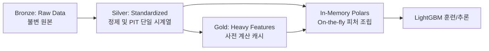

# 2026 현업 퀀트 시스템 트레이딩 데이터 아키텍처 & 파이프라인 핸드북

> **핵심 요약:** LightGBM 기반 머신러닝 퀀트 트레이딩에서 모델 성능과 생존의 90%는 데이터 파이프라인의 **"지표 분리(Decoupling)"**와 **"시점 무결성(Point-in-Time Alignment)"**에서 결정됩니다.

---

## 목차
1. [3단계 데이터 계층화 (Medallion Architecture)](#1-3단계-데이터-계층화-medallion-architecture)
2. [이종 데이터 분류 체계 (차원과 주기 분리)](#2-이종-데이터-분류-체계-차원과-주기-분리)
3. [시점 정렬(Temporal Alignment)과 룩어헤드 방어](#3-시점-정렬temporal-alignment과-룩어헤드-방어)
4. [지표 저장 전략: On-the-Fly vs Pre-computed](#4-지표-저장-전략-on-the-fly-vs-pre-computed)
5. [피처 레지스트리(Feature Registry) 구현 패턴](#5-피처-레지스트리feature-registry-구현-패턴)
6. [데이터 무결성 검증 게이트 (Data Gate & IC Rule)](#6-데이터-무결성-검증-게이트-data-gate--ic-rule)
7. [피처 스크리닝(Feature Screening)과 P-해킹 방지 필터](#7-피처-스크리닝feature-screening과-p-해킹-방지-필터)
8. [표준 프로젝트 디렉터리 구조](#8-표준-프로젝트-디렉터리-구조)

---

## 1. 3단계 데이터 계층화 (Medallion Architecture)

현업에서는 수집 데이터, 가공 데이터, 모델 입력 데이터를 절대 한곳에 섞지 않습니다.



1. **Bronze (Raw Data Lake)**
   * 거래소, 증권사 API, 매크로 벤더로부터 수신한 순수 원본(JSON, CSV, PCAP 틱 패킷).
   * **원칙:** 불변(Immutable). 결측치나 오류가 있어도 절대 수정하지 않고 원본 그대로 보존.
2. **Silver (Standardized & Cleaned)**
   * 타임스탬프 표준화(UTC 기준), 종목 심볼 매핑 히스토리 관리.
   * 액션 처리: 수정주가(배당, 액면분할) 반영, 비정상 틱 필터링.
   * **생존 편향(Survivorship Bias) 방지:** 상장폐지 종목 데이터도 동일한 포맷으로 유지.
3. **Gold (Heavy Feature Store / Cache)**
   * 사전 계산이 불가피한 무거운 지표(호가창 틱 집계, 횡단면 순위, 매크로 결합치 등)만 선별 저장.

---

## 2. 이종 데이터 분류 체계 (차원과 주기 분리)

서로 다른 주기와 성격을 가진 데이터를 무작정 하나의 거대한 테이블로 묶으면 시스템이 붕괴합니다.

| 분류 도메인 | 대상 데이터 예시 | 주 기 | 관리 단위 (Entity) |
| :--- | :--- | :--- | :--- |
| **단일 자산 (Single-Asset)** | 주식/선물 OHLCV, 틱, 개별 지표 | 고빈도 (1분, 5분, 일봉) | `[timestamp, symbol]` |
| **횡단면/관계형 (Cross-Sectional)** | 섹터 ETF, 대장주 대비 상대수익률, 롤링 베타 | 중빈도 (일봉, 분봉) | `[timestamp, symbol, sector]` |
| **거시/글로벌 (Global / Macro)** | 국채금리, 환율, VIX, 스프레드, 공시 | 저빈도/비정기 (일/월/이벤트) | `[announced_at]` (No symbol) |

### 중추(Spine) 기반 결합 기법
* 모델을 학습시킬 기준이 되는 **타겟 종목의 매매 타임스탬프가 척추(Spine)**가 됩니다.
* 모든 섹터 및 매크로 지표는 런타임에 이 Spine 테이블에 **`join_asof`** 또는 **`Left Join`**으로 얹어줍니다.

---

## 3. 시점 정렬(Temporal Alignment)과 룩어헤드 방어

백테스트 성과는 화려하지만 실거래에서 깡통을 차는 전략의 99%는 시간 정보의 착각에서 발생합니다.

### 3대 시간 지뢰 및 방어 룰
1. **봉 마감 시점(Closed-at) 강제 통일:**
   * 거래소마다 10:00 봉의 의미가 다름 (시작 시점 vs 마감 시점).
   * 모든 내부 타임스탬프는 **"이 데이터가 시장에서 완전히 닫혀 확정된 시각(`closed_at` / `available_at`)"** 단 하나로 변환합니다.
2. **체결 지연(Execution Delay) 강제 적용:**
   * $t$ 시점 마감 데이터로 계산한 지표는 **$t+1$ 시점 시가(Open) 또는 그 이후의 가중평균가(VWAP)**로 진입해야 합니다.
   * 종가(Close)로 즉시 체결되었다고 가정하는 것은 미래 참조입니다.
3. **매크로 데이터의 Point-in-Time (PIT) 매핑:**
   * 대상 기간(`reference_period`)이 아니라 **실제 시장 공개 시각(`announced_at`)**을 키로 사용.
   * `tolerance` 파라미터로 지나치게 오래된 과거 값 매핑 차단.

```python
# Polars 기반 시점 정렬 예시
dataset = stock_spine.sort("closed_at").join_asof(
    macro_features.sort("announced_at"),
    left_on="closed_at",
    right_on="announced_at",
    strategy="backward",  # closed_at 시점 직전의 확정 데이터만 결합
    tolerance="5d"        # 최대 5일 이내 발표된 데이터만 유효
)
```

---

## 4. 지표 저장 전략: On-the-Fly vs Pre-computed

모든 파라미터 조합(RSI 14, 21, 28 등)을 디스크에 저장하면 **용량 폭발(Combinatorial Explosion)**과 I/O 병목이 발생합니다.

> **💡 현대 퀀트의 I/O 역전 현상:**
> 최신 Rust/C++ 기반 엔진(Polars)으로 메모리에서 지표 100개를 계산하는 시간(1~2초)이, SSD에서 50GB 크기의 거대한 지표 테이블을 읽어오는 I/O 시간보다 훨씬 빠릅니다.

* **Tier 1: Pre-computed (Gold 디스크 저장)**
  * 연산량이 극도로 크거나 전 종목 상호 비교가 필요한 지표 (L2 호가창 불균형, 2,000개 종목 상관계수 행렬, NLP 감성 점수).
* **Tier 2: On-the-Fly (디스크 미저장 / 런타임 인메모리 연산)**
  * 단일 종목 OHLCV로 나오는 모든 기술적 지표 (RSI, MACD, 볼린저밴드, 변동성, 이평선 괴리율 등).
  * 파라미터 변경 시 디스크 재생성 없이 YAML 설정만 바꾸면 즉시 반영.

---

## 5. 피처 레지스트리(Feature Registry) 구현 패턴

지표 정의를 순수 함수(Pure Function)로 모듈화하여 리서치와 실거래 봇이 동일한 코드를 공유합니다.

```python
# features/indicators.py
import polars as pl

FEATURE_REGISTRY = {}

def register_feature(name):
    def decorator(func):
        FEATURE_REGISTRY[name] = func
        return func
    return decorator

@register_feature("rsi")
def calc_rsi(df: pl.LazyFrame, window: int = 14) -> pl.Expr:
    diff = pl.col("close").diff().over("symbol")
    gain = pl.when(diff > 0).then(diff).otherwise(0).rolling_mean(window).over("symbol")
    loss = pl.when(diff < 0).then(-diff).otherwise(0).rolling_mean(window).over("symbol")
    rs = gain / (loss + 1e-9)
    return (100 - (100 / (1 + rs))).alias(f"rsi_{window}")
```

```python
# train.py (동적 지표 조립)
def assemble_features(lf: pl.LazyFrame, feature_config: list[dict]) -> pl.DataFrame:
    exprs = [FEATURE_REGISTRY[c["name"]](lf, **c["params"]) for c in feature_config]
    return lf.with_columns(exprs).collect()
```

---

## 6. 데이터 무결성 검증 게이트 (Data Gate & IC Rule)

### IC(Information Coefficient)의 현실적 기준선
* 일반적인 주식 팩터: **0.01 ~ 0.04 (1~4%)** 수준이면 충분한 알파.
* **그리놀드 법칙 (Fundamental Law of Active Management):**
  $$IR \approx IC \times \sqrt{N}$$
  베팅 횟수($N$)가 많으면 $IC = 0.03$으로도 샤프 2.0 이상의 고수익 달성 가능.
* **IC $\ge$ 0.15 ~ 0.20:** 현업에서는 이를 알파로 보지 않고 **99.9% 미래 데이터 유출(Leakage) 버그**로 판정.

### 10줄짜리 최후 방어선 (Sanity Check)
```python
def validate_dataset(df: pl.DataFrame, feature_cols: list[str], target_col: str):
    # 1. 시간 순서 정렬 및 중복 캔들 검증
    ts = df["timestamp"].to_list()
    assert all(ts[i] <= ts[i+1] for i in range(len(ts)-1)), "타임스탬프 순서 역전!"
    assert df["timestamp"].is_duplicated().sum() == 0, "중복 타임스탬프 존재!"

    # 2. 무한대(Inf) 검증
    for col in feature_cols:
        assert df[col].is_infinite().sum() == 0, f"피처 {col}에 Inf 값 발견!"

    # 3. 누수(Lookahead) 탐지: IC 0.2 룰
    for col in feature_cols:
        valid = df.select([col, target_col]).drop_nulls()
        corr = np.corrcoef(valid[col], valid[target_col])[0, 1]
        assert abs(corr) < 0.20, f"피처 {col}의 IC가 {corr:.3f}입니다. 룩어헤드 버그를 확인하세요!"
```

---

## 7. 피처 스크리닝(Feature Screening)과 P-해킹 방지 필터

수천 개의 지표를 무지성으로 조합해 최고 성과를 뽑으면, 통계적 착시(P-hacking)로 인해 실전에서 필패하는 기괴한 지표가 1등을 차지합니다.

### 실무 3중 안전 필터링
1. **경제적 가설 필터 (Economic Rationale):**
   * "왜 이 지표가 작동해야 하는가?" (시장 참여자의 심리, 유동성 제약, 차익거래 비용 등) 설명할 수 없는 파라미터는 즉시 제외.
2. **안정성 지표 (IC_IR) 검증:**
   $$\text{IC\_IR} = \frac{\text{Mean}(IC)}{\text{Std}(IC)}$$
   * 일시적인 폭락장 뽀록을 배제하고, 시계열상 꾸준히 일관된 부호를 유지하는 지표만 통과.
3. **계층적 군집화 (Hierarchical Clustering):**
   * 상호 상관계수가 0.85 이상인 지표들(RSI 13, 14, 15 등)을 클러스터로 묶어 대표 지표 1개만 선발. 다중공선성 해소 및 모델 차원 축소.
4. **SHAP Value (TreeSHAP) 사후 검증:**
   * LightGBM 단순 Split 횟수에 속지 않고, 예측 분포에 실질적으로 기여했는지 판별.

---

## 8. 표준 프로젝트 디렉터리 구조

```text
quant_trading/
├── data/
│   ├── bronze/                   # 불변 원본 데이터 (Raw Tick, JSON)
│   ├── silver/                   # 정제된 시계열 원데이터 (OHLCV, 조정주가, Macro)
│   └── gold/                     # 무거운 가공 데이터 캐시 (L2 집계, 횡단면 순위)
│
├── config/
│   └── features.yaml             # 실험할 지표 레시피 선언 (YAML)
│
├── src/
│   ├── features/
│   │   ├── registry.py           # 데코레이터 및 레지스트리 관리
│   │   ├── momentum.py           # 온더플라이 순수 함수들
│   │   ├── volatility.py
│   │   └── cross_sectional.py
│   │
│   ├── validation/
│   │   └── data_gate.py          # 정렬, Inf, IC 0.2 룰 검증 모듈
│   │
│   ├── models/
│   │   ├── trainer.py            # LightGBM 훈련기
│   │   └── cv.py                 # Purged & Embargoed TimeSeries Split
│   │
│   └── execution/
│       └── live_engine.py        # 실거래 봇 (features 모듈을 동일하게 임포트)
```
