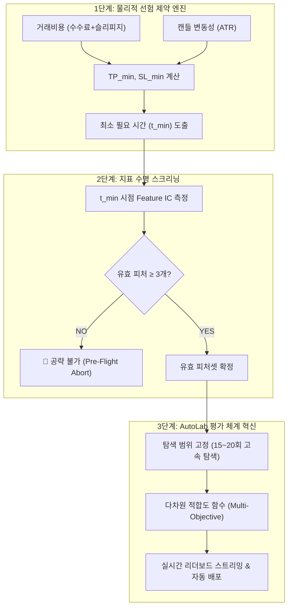

# 퀀트 트레이딩 시스템 과학적 고도화 계획서 (2026-09-11)
**문서 코드**: `QUANT-ENHANCE-20260911-01`  
**대상 시스템**: `CAiModelBaker` (퀀트 엔진) & `CTrade` (실전 매매 엔진)  
**작성 기준**: 가상자산/국내주식 계량 금융공학 표준 (First Passage Time & Feature Half-Life Matching)

---

## 1. 배경 및 현주소 진단

### 1.1 비트코인 10분봉 실전 검증의 교훈
1. **마찰력 대비 변동성 한계 (Friction vs Volatility Mismatch)**:
   - 비트코인 10분봉 1개 캔들의 평균 변동폭(ATR)은 약 `0.20%`이나, 왕복 거래 비용(수수료 0.10% + 슬리피지 0.12%)은 `0.22%`임.
   - 단일 캔들 움직임 전체가 수수료로 소멸되므로, 고빈도 매매(월 15회 이상) 시 계좌가 필연적으로 우하향함.
   - 머신러닝이 수수료를 극복하기 위해 찾은 유일한 해법은 '확실한 파동만 노리는 월 2~3회 스나이퍼 매매'였음.
2. **블라인드 탐색의 비효율 (선험적 제약 부재)**:
   - 시스템이 물리적 제약 조건(수수료 $\to$ 최소 목표익 $\to$ 최소 필요 시간)을 사전에 계산하지 않고, Optuna/AutoLab에 0~100의 넓은 범위를 던져주어 50분 이상의 무의미한 연산과 오버피팅을 유발함.
3. **지표 수명과 예측 지평의 분절 (Feature-Horizon Mismatch)**:
   - 120분을 내다봐야 하는 모델에 5분짜리 초단기 노이즈 지표(`binance_ret_5m`)를 혼합 투입하여 모델의 일반화 성능을 저하시킴.

---

## 2. 3단계 시스템 고도화 아키텍처

---

## 3. 세부 단계별 구현 명세

### [1단계] 물리적 선험 제약 엔진 (`core/physics_constraint.py`)
- **수학적 공식 정의**:
  - **최소 익절폭 ($TP_{min}$)**: $\text{Friction (Roundtrip)} \times 3.5$ (ATR 기준 약 4.0배)
  - **최소 손절폭 ($SL_{min}$)**: $\text{Single Bar Noise Floor} = 2.0 \times \text{ATR}$
  - **최소 예측 시간 ($t_{min}$)**: 가격 확산 방정식(First Passage Time) 기반:
    $$t_{min} = \left\lceil \left(\frac{TP_{min}}{\text{ATR}}\right)^2 \right\rceil$$
- **기능**:
  - 학습 시작 전 `active.json` 및 Optuna 파라미터 범위를 해당 물리적 하한치로 자동 바인딩(Auto-binding).
  - 비물리적인 파라미터 조합(예: 60분 내 TP 5.0 ATR 달성 등)의 사전 제거.

### [2단계] 지표 수명-지평 적합성 스크리닝 (`core/feature_screener.py` 연동)
- **정보 반감기(Information Half-Life) 검증**:
  - 산출된 $t_{min}$ 시점에서 각 지표의 스피어만 순위 상관계수(Rank IC) 계산.
  - $|IC| < 0.02$ 또는 $p\text{-value} > 0.05$인 단기 노이즈 지표 자동 탈락.
- **사전 적합성 판정 (Pre-Flight Filter)**:
  - $t_{min}$을 커버할 수 있는 유효 지표가 3개 미만일 경우:
    `"해당 타임프레임은 마찰력 대비 예측 지표 부재로 공략 불가"` 판정 후 조기 종료 (시간 낭비 방지).

### [3단계] AutoLab 평가 체계 및 UX 개편 (`core/research_loop.py` & 대시보드)
- **정적 거래수 강제 폐지**:
  - `min_trades = 12` 하드코딩 제거.
  - **다차원 적합도 점수(Multi-Objective Composite Fitness)** 도입:
    $$\text{Fitness} = \text{Profit Factor} \times \text{Win Rate} \times \text{Sharpe} \times \ln(\text{Trades} + 1)$$
    (거래수가 적더라도 고승률, 고샤프 모델은 최우수 등급으로 인정).
- **실시간 리더보드 스트리밍**:
  - 80회 완주 대기 없이, 매 Trial 완료 시마다 실시간으로 상위 3개 후보 갱신 및 웹소켓 브로드캐스트.
- **탐색 횟수 슬림화**:
  - 80회 무작위 탐색 $\to$ 15~20회 조합 탐색 (소요 시간 50분 $\to$ 3~5분 단축).

---

## 4. 검증 및 문서화 계획
- **테스트 코드**: `tests/test_physics_constraint.py` 작성 및 `pytest -v` 전수 검증.
- **문서 동기화**: `docs/ARCHITECTURE.md`, `docs/STRATEGY.md`, `README.md` 실시간 업데이트.
- **결과 리포트**: 완료 후 `docs/reports/QUANT_SYSTEM_ENHANCEMENT_RESULT_20260911.md` 발행.
