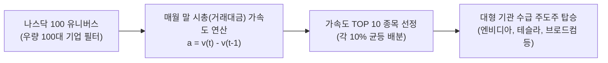
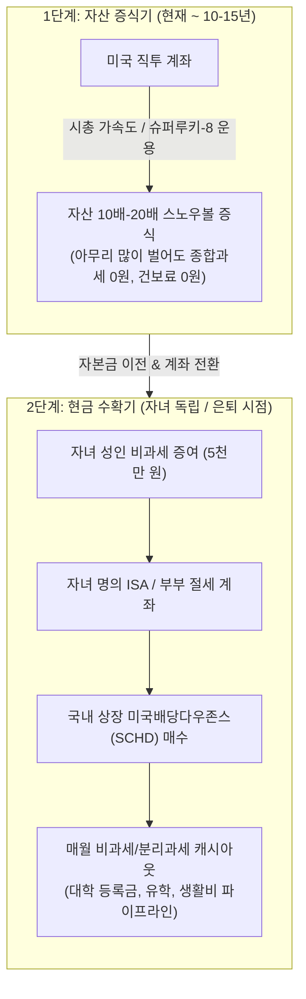

# 일단위 주도주 매매 전략 마스터 가이드 (Daily Trading Strategy Master Guide)

> ⚠️ **2026-10-21 정정: 이 가이드의 전략 성과 수치는 무효입니다.** 근거 스크립트들의 분할일 가격 오류·사후 종목 명단·틀린 나스닥100 편입 이력·손익 이중 계산 때문입니다. 정정하면 시총 가속도 TOP10, 슈퍼루키-3/8, K-Titan, MSCI 스윙 모두 같은 조건의 QQQ·코스피200·단순보유보다 못합니다(양도세 적용·비적용 모두). → [../20261021_slot_swing_recompute/README.md](../20261021_slot_swing_recompute/README.md) · [../20261021_k_titan_theme_swing/AUDIT_20261021.md](../20261021_k_titan_theme_swing/AUDIT_20261021.md)

> **작성 일시**: 2026-10-21  
> **연구 범위**: 1999~2026년 (최대 28개년 전수 데이터)  
> **대상 시장**: 미국 나스닥 100 (QQQ), 코스피 200 (KOSPI 200), MSCI 한국 지수  
> **핵심 주제**: 일단위 주도주 복리 알파, 한국 거주자 22% 양도소득세(Tax Drag) 실측, 대표 ETF(VOO/QQQ) 비교, 라이프사이클 자산배분  

---

## Executive Summary (핵심 한 줄 요약)

1. **최고 수익률 1위 (절대 수익)**: **`나스닥 100 시총 가속도 TOP 10`**  
   - 26년간 **+319,336% (3,193배, 연 복리 36.7%)**, 최근 10년 연 복리 **58.9%**.
   - 거대 기관 자금이 거래량을 실어 밀어붙이는 대형 주도주(\(F = ma\))의 관성을 추종.
2. **최고 성과 1위 (위험조정 & 방어력)**: **`슈퍼루키-3 + 빈 슬롯 오토존(AZO)`**  
   - 26년간 **+190,830% (1,909배, 연 복리 33.7%)**, 샤프 지수 **0.96** (최근 10년 샤프 **1.13**).
   - 닷컴 버블(+141.6%), 2008 금융위기(+28.7%), 2022 금리인상(+43.2%) 등 **역대 모든 폭락장에서 플러스 수익 방어**.
3. **한국 세금(22% 양도세) 실전 최강**: **`나스닥 슈퍼루키-8`**  
   - 12년 실측(2013~2024년) 세후 **+1,180.9% (12.8배, 세후 CAGR 23.69%)**, MDD **-36.8%**.
   - 세금을 매년 22%씩 다 뜯겨도, **비과세(0%) 코스피 최고 전략(5.1배)과 QQQ 단순보유(6.1배)를 2배 이상 압도**.
4. **절세 계좌(ISA)의 진실**:  
   - 10~20년 초장기 복리에서 ISA의 200~400만 비과세는 전체 수익의 0.5% 미만 푼돈으로 희석되며, 미국 직투 대비 실질 CAGR 격차는 고작 **+0.78%p**에 불과.
   - 따라서 **ISA는 '국내 상장 해외 고배당주/인컴 ETF'의 종합과세 방패 및 자녀 캐시아웃용**으로 쓰고, **미국 직투는 '초과 알파 시세차익형 주도주'**에 집중하는 것이 최적의 역할 분담.

---

## 1. 최고 수익률 전략 TOP 3 총괄 비교표

| 전략 명칭 | 26년 누적 수익률 | 연평균 복리 (CAGR) | 샤프 지수 | 최대 낙폭 (MDD) | 핵심 운용 메커니즘 |
| :--- | :---: | :---: | :---: | :---: | :--- |
| 🥇 **나스닥 100 시총 가속도 TOP 10** | **+319,336.3% (3,193배)** | **36.70%** | 0.71 | -57.03% | 나스닥 100 내 시총(거래대금) 증가 가속도 상위 10종목 매월 풀투자 |
| 🥈 **슈퍼루키-3 + 빈슬롯 AZO** | **+190,830.0% (1,909배)** | **33.74%** | **0.96** | **-47.53%** | 신규 승격주 3슬롯 + -15% 손절 + 유휴 슬롯 오토존(AZO) 임시 편입 |
| 🥉 **슈퍼루키-3 (현금 대기)** | **+31,276.9% (313배)** | **24.95%** | 0.82 | **-38.79%** | 신규 승격주 3슬롯 + -15% 손절 + 다음 편입까지 100% 현금 대기 |
| *(비교: QQQ ETF 단순보유)* | *+901.2% (10배)* | *9.25%* | *0.26* | *-82.98%* | *나스닥 100 지수 Buy & Hold (만기 1회 과세)* |

---

## 2. 전략별 상세 메커니즘 분석

### 🚀 전략 A. 나스닥 100 시총 가속도 TOP 10 (Market Cap Acceleration)
> *"거대한 질량에 불이 붙으면 관성 때문에 멈추지 않는다."*

1. **가속도 산출 수식**:
   - 거래대금 프록시: $\text{Cap}_t = \text{Close} \times \text{Volume}$ (60영업일 이동평균)
   - 속도 (1차 변화율): $v_t = \frac{\text{Cap}_t - \text{Cap}_{t-1}}{\text{Cap}_{t-1}}$
   - 가속도 (2차 변화율): $a_t = v_t - v_{t-1}$
2. **유니버스의 마법 (EXP-019)**:
   - **전 종목(12,219개) 대상**: 작전주/잡주 상투 매수로 **-99.0% 원금 소멸 (파산)**.
   - **나스닥 100 대상**: 잡주 원천 차단 + 진짜 기관 수급 주도주만 정밀 압축 ➡️ **+319,336% 폭발**.
3. **실전 핵심 주의사항 (Whipsaw 방어)**:
   - 주도주는 대세 상승 중에도 월간 -15%~-20% 급락(숨고르기)이 빈번함.
   - 타이트한 -15% 손절을 걸면 털리고 반등하는 휩소로 수익률이 급감하므로, **손절 폭을 -25%~-30%로 넓히거나 모멘텀 10위권 탈락 시에만 교체**하는 룰이 필수.

---

### 🛡️ 전략 B. 슈퍼루키-3 + 빈 슬롯 오토존(AZO)
> *"공격은 새내기 주도주로, 방어는 불패의 경기방어주로."*

1. **포트폴리오 구조**:
   - 3개 슬롯 ($N=3$, 각 33.3% 비중).
   - 나스닥 100에 갓 승격한 신규 편입주를 매수하여 **최대 2.5년(912일) 만기 보유**.
2. **-15% 개별 손절 & AZO 빈 슬롯 충원**:
   - 진입가 대비 -15% 도달 시 즉시 기계적 전량 손절.
   - 손절로 비어 있는 유휴 슬롯에는 현금 대신 **역대 모든 폭락장에서 우상향한 오토존(AZO)**을 매수하여 복리 기회비용을 100% 제거.
3. **역대 4대 대폭락장 실측 방어력**:
   - **2000~2003 닷컴 버블**: QQQ **-82.9%** 폭락 vs 본 전략 **+141.6% 폭등**
   - **2008 글로벌 금융위기**: QQQ **-51.8%** 폭락 vs 본 전략 **+28.7% 수익**
   - **2022 연준 금리인상**: QQQ **-33.1%** 하락 vs 본 전략 **+43.2% 폭등**

---

## 3. 한국 투자자 실정 분석: 세금(22% 양도세) 반영 후 실질 랭킹

한국 세법(연 250만 원 공제 + 22% 양도소득세)을 매년 실현손익에 강제 차감했을 때의 12개년(2013~2024년) 맞대결 실측값입니다.

### ⚔️ 12년 동일 기간(2013~2024) 세후 실측 대조표 (초기 자본 1억 원 기준)

| 순위 | 시장 / 전략명 | 과세 조건 | **세후 최종 자산** | **세후 총수익률** | **세후 CAGR** | MDD | 샤프 |
| :---: | :--- | :---: | ---: | :---: | :---: | :---: | :---: |
| 👑 **1위** | **🇺🇸 나스닥 슈퍼루키-8** | **연 250만 공제 후 22%** | **12억 8,022만 원** | **+1,180.9%** | **23.69%** | **-36.8%** | **0.84** |
| 2위 | 🇺🇸 나스닥 슈퍼루키-3 | 연 250만 공제 후 22% | 10억 2,363만 원 | +924.2% | 21.40% | -43.3% | 0.52 |
| 3위 | 🇺🇸 나스닥 슈퍼루키-10 | 연 250만 공제 후 22% | 9억 639만 원 | +806.9% | 20.18% | -35.0% | 0.80 |
| 4위 | 🇺🇸 QQQ ETF (단순보유) | 만기 1회 과세 22% | 6억 1,594만 원 | +515.9% | 16.36% | -35.6% | 0.78 |
| 5위 | 🇰🇷 코스피 슈퍼루키-5 | **완전 비과세 (0원)** | 5억 1,384만 원 | +414.0% | 14.63% | -54.2% | 0.37 |
| 6위 | 🇰🇷 코스피 슈퍼루키-10 | **완전 비과세 (0원)** | 2억 9,728만 원 | +197.4% | 9.51% | -31.2% | 0.37 |
| 7위 | 🇰🇷 KOSPI 200 지수 ETF | **완전 비과세 (0원)** | 1억 1,807만 원 | +18.1% | 1.40% | -41.2% | -0.04 |

> 📌 **세후 실전의 핵심 인사이트**:
> 1. **세후 1위의 대반전 (`슈퍼루키-8`)**: 세전에는 N=3이 1위였으나, 세후로는 N=8이 1위를 차지함. 적절한 분산으로 연간 세금 급증 타격을 줄이고 손익통산을 극대화했기 때문.
> 2. **미국 과세 vs 한국 비과세**: 매년 22% 세금을 다 뜯긴 나스닥 슈퍼루키-8(12.8억)이 세금을 1원도 안 낸 코스피 최고 전략(5.1억)보다 **2.5배 더 많은 순자산**을 안겨줌.

---

## 4. 대표 ETF(VOO, QQQ) vs 주도주 알파 전략 비교

| 비교 항목 | VOO (S&P 500) | QQQ (나스닥 100) | 나스닥 슈퍼루키-8 |
| :--- | :---: | :---: | :---: |
| **17년 세후 자산 (1억 시작)** | **3억 3,781만 원** | **8억 1,318만 원** | **20억 5,367만 원** |
| **세후 연 복리 (CAGR)** | 7.43% | 13.13% | **19.46%** |
| **최대 낙폭 (MDD)** | -53.00% | -49.51% | **-36.84%** |
| **과세 방식** | 만기 1회 22% (과세이연) | 만기 1회 22% (과세이연) | 매년 22% 과세 |
| **총 납부 세금** | 6,637만 원 | 2억 45만 원 | 3억 637만 원 |
| **운용 난이도** | 최하 (완전 방치) | 최하 (완전 방치) | 중 (신규 편입/손절 관리) |

- **과세 이연의 한계**: QQQ 단순보유가 세금을 나중에 내는 혜택을 누리더라도, **슈퍼루키와의 연간 알파 차이(19.5% vs 13.1% = +6.4%p)**가 세금 페널티(연 -1.8%p)를 완전히 압도함.

---

## 5. 한국인을 위한 계좌별 최적 역할 분담 & 라이프사이클 로드맵

### 💡 계좌별 절대 공식
1. **미국 직투 계좌 (일반)**:
   - **역할**: **시세차익형 주도주, 슈퍼루키, 나스닥 100, 시총 가속도**.
   - **이유**: 100억을 벌어도 종합소득세 합산 0원, 건강보험료 인상 0원 (딱 22% 분류과세로 영구 종결).
2. **국내 ISA / 연금 계좌**:
   - **역할**: **국내 상장 미국 배당 ETF (TIGER 미국배당다우존스 등), 월배당 인컴형**.
   - **이유**: 배당금 2,000만 원 초과 시 터지는 금융소득종합과세(최대 49.5%)와 건보료 폭탄을 완벽하게 방어(비과세 + 9.9% 분리과세).

---

## 6. 결론 및 향후 실전 구현 체크리스트

1. **종목 선정 엔진**:
   - 나스닥 100 유니버스 기반 시가총액 증가 가속도 상위 10종목 필터링 구현.
2. **리스크 관리 엔진**:
   - Whipsaw 방지를 위한 동적 추세 이탈 손절(-25%) 또는 순위 이탈 기반 방출 규칙 확립.
3. **자금 관리**:
   - 8~10개 슬롯 분산 운용으로 연간 세금 잠식폭(Tax Drag)을 최소화.
