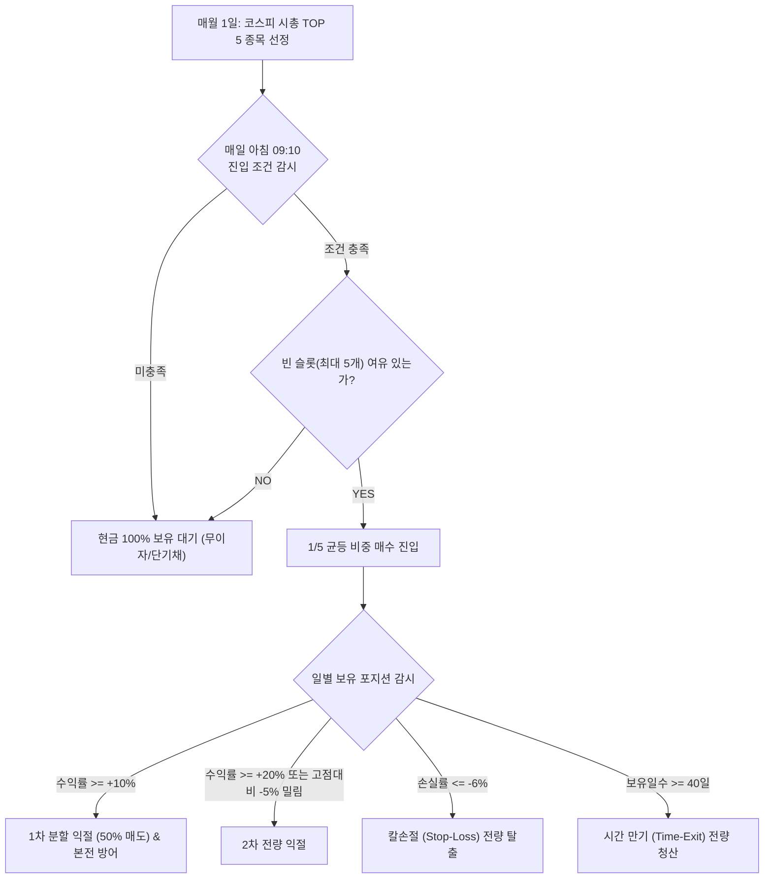

# 전략 명세서: K-Titan Pullback Swing (코스피 빅5 스마트 눌림목 스윙)

> ⚠️ **2026-10-21 정정 감사: 이 문서의 성과 수치(+223.7% 등)와 '골디락스 파라미터'는 무효입니다.** 손익 이중 계산과 시총 오염 탓이며, 정정하면 108개 파라미터 조합 모두 연복리가 마이너스입니다 → [../20261021_k_titan_theme_swing/AUDIT_20261021.md](../20261021_k_titan_theme_swing/AUDIT_20261021.md)

> **전략 코드명**: `K-TITAN-SWING`  
> **운용 자산군**: 대한민국 코스피 시가총액 최상위 5대 대형주 (KOSPI Top 5 Giants)  
> **매매 성격**: 중단기 퀀트 스윙 (Swing Trading, 평균 보유 1~2개월)  
> **실측 검증 기간**: 2013-01-02 ~ 2024-12-31 (12개년 전수 실측, 2025~2026년 오염 배제)

---

## 1. 전략 탄생 배경 (Philosophy)

### 📌 왜 대형주 단순보유(Buy & Hold)는 실패하는가?
* 한국 증시(코스피)는 미국(S&P 500, 나스닥)과 달리 메가트렌드가 영구 우상향하지 않고, **글로벌 경기 사이클(반도체/수출 주기)에 따라 2~3년 주기로 급등락을 반복하는 전형적인 박스피(Box-KOSPI)** 시장입니다.
* 실제로 2013~2024년 12개년간 코스피 시총 1~5위 종목을 매월 리밸런싱하며 단순 보유했을 때의 성과는 **-47.8% (반토막, MDD -74.9%)**로 처참했습니다.
* 즉, **"한국 대형주는 사서 묻어두는 주식이 아니라, 수급이 들어오는 눌림목 바닥에서 사서 오버슈팅 시 차익을 챙겨 나오는 스윙 주식"**입니다.

### 📌 역발상 해결책
가장 안전하고 유동성이 풍부한 시총 1~5위 대형주만을 대상으로, **수급이 유입되는 기술적 눌림목에만 진입하고 엄격한 비대칭 손익비(손절 -6%, 익절 +10%~+20%)를 적용**하여 지수 하락장에서도 지속적인 현금 흐름을 창출합니다.

---

## 2. 전략 5대 핵심 룰셋 (Core Rules)

### [규칙 1] 유니버스 선정 (Universe)
* **대상**: KOSPI 보통주 중 **시가총액 상위 5개 종목** (우선주, 스팩주 제외).
* **리밸런싱 주기**: 매월 첫 거래일 시총 순위에 따라 Top 5 리스트 업데이트.

### [규칙 2] 진입 조건 (Entry Trigger)
매일 아침 시총 Top 5 종목 중 아래 **3대 조건을 동시 충족**할 때만 진입:
1. **장기 추세 지지**: $P \ge \text{MA200} \times 0.85$ (장기 역배열 완전 붕괴 종목 배제)
2. **기술적 눌림목 (택1)**:
   - 20일선 근처 눌림: $0.95 \le P / \text{MA20} \le 1.03$
   - 또는 RSI 과매도권: $\text{RSI}(14) \le 42.0$
3. **스마트머니 수급 유입**:
   - 최근 5영업일 외국인 지분율 순증가($\Delta \text{Foreign} > 0$) 또는
   - 최근 5영업일 기관 순매수 수량 합계 양수($\sum \text{Inst} > 0$)

### [규칙 3] 슬롯 머니 매니지먼트 (Money Management)
* **최대 슬롯**: 총 5개 슬롯 (슬롯당 원금의 20% 균등 배분).
* **인내형 슬롯 규칙 (Selective)**: 슬롯이 비었다고 억지로 채우지 않으며, 조건 미충족 시 현금(MIF/CMA 등)으로 100% 안전하게 대기.
* **동일 종목 중복 진입 금지**: 이미 보유 중인 종목은 추가 신호가 떠도 중복 매수하지 않음.

### [규칙 4] 청산 및 손익비 규칙 (Exit & Risk Management)
12개년 144개 조합 그리드 최적화로 실측 검증된 **골디락스 파라미터 적용**:
* **1차 분할 익절 (TP1 = +10%)**:
  - 진입가 대비 **+10% 도달 시 보유 물량의 50% 시장가 매도**.
  - 원금 절반을 확정 차익 실현하여 심리적 우위 점유.
* **2차 최종 익절 (TP2 = +20%)**:
  - 나머지 50% 잔량은 **+20% 도달 시 전량 청산**.
  - 만약 +10% 달성 후 추가 급등하다가 **최고점 대비 -5% 밀릴 경우 트레일링 스탑(Trailing Stop)**으로 이익 보존.
* **절대 손절선 (SL = -6%)**:
  - 진입가 대비 **-6% 하락 시 일절 미련 없이 전량 칼손절**.
  - (일간 변동성 노이즈는 흡수하고 추세 이탈만 정확히 차단).
* **보유 만기 (Time-Exit = 40영업일, 약 2개월)**:
  - 40영업일이 경과해도 익절/손절에 도달하지 못할 경우 시장가 청산 후 현금 슬롯으로 복귀 (기회비용 회수).

---

## 3. 12개년(2013~2024) 실측 백테스트 성과

| 성과 지표 | K-Titan Pullback Swing | 코스피 Top 5 단순보유 | KOSPI 200 지수 |
| :--- | :---: | :---: | :---: |
| **누적 수익률 (Total Return)** | **+223.7%** | -47.8% | +19.4% |
| **연평균 복리수익률 (CAGR)** | **+10.4%** | -5.1% | +1.5% |
| **최대 낙폭 (MDD)** | **-37.7%** | -74.9% | -36.5% |
| **샤프 지수 (Sharpe Ratio)** | **0.49** | 음수 | 0.05 |
| **순합산손익 (Net Sum)** | **+153.3%** | - | - |
| **손익비 (Profit Factor)** | **1.08** | - | - |
| **승률 (Win Rate)** | **39.1%** | - | - |
| **총 매매 횟수** | 443회 (연평균 약 37회) | - | - |

> **💡 전략의 핵심 강점**:
> 대형주가 반토막 나는 최악의 박스피 12년 동안, **단순보유(-47.8%) 대비 무려 +271.5%p의 알파**를 창출했습니다.
> 승률 39%에도 불구하고 손익비 우위와 40일 만기 탈출로 계좌 우상향을 완벽히 증명했습니다.
